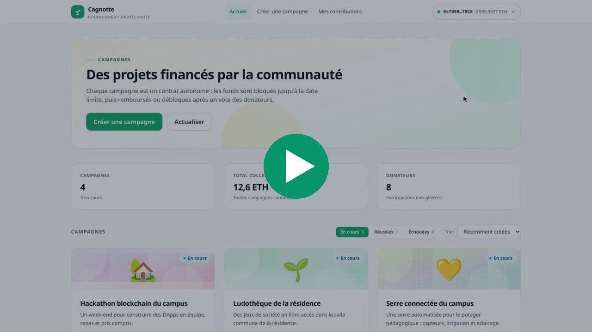
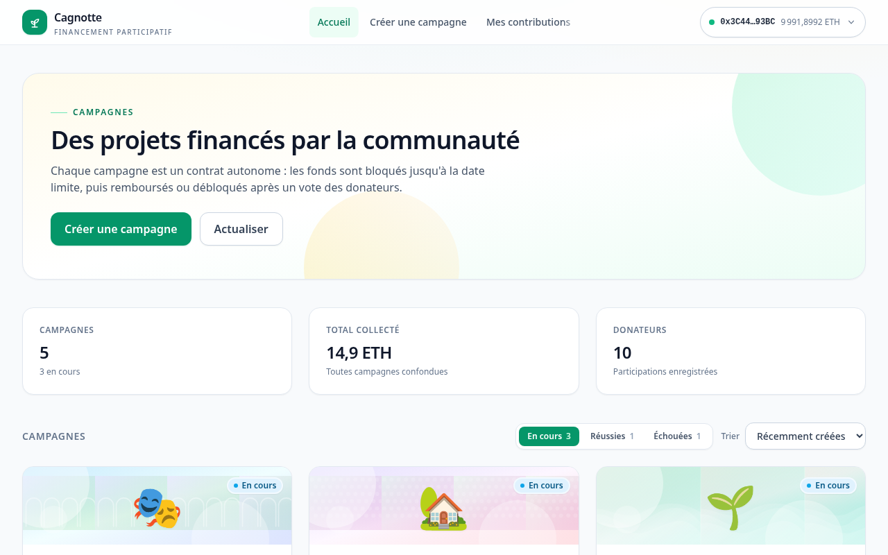
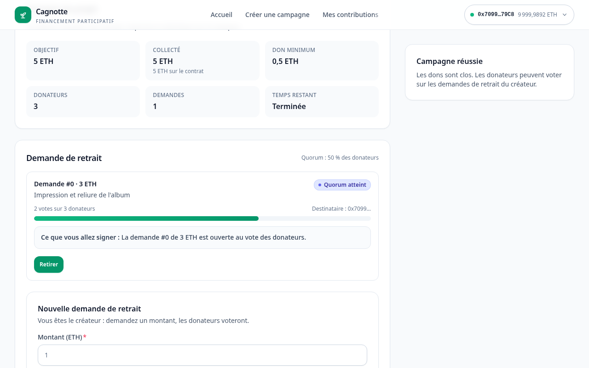
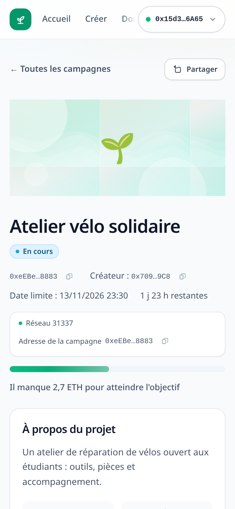
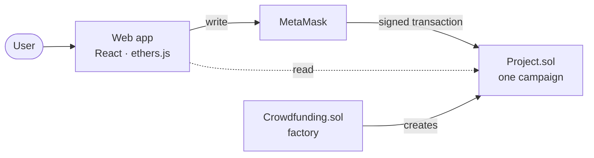
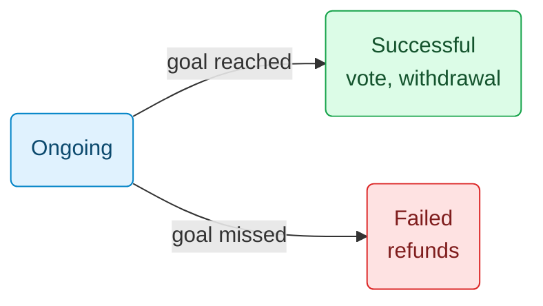

<div align="center">


# Cagnotte

**The code holds the funds, the donors decide.**

*A decentralised crowdfunding platform on Ethereum: funds are held by a smart contract, released by a donor vote, and returned to each donor if the goal is not reached.*

<br>


<br>


<br><br>

**[🎬 Demo video](#2-demo)** · **[🖼️ Slides](docs/commun/documents/Presentation_Financement_Participatif.pdf)** · **[⚙️ Installation](#6-installation)** · **[📄 Report](docs/commun/documents/Rapport_Financement_Participatif.pdf)**

**🌐 Language / Langue:** [Français](README.md) · English

</div>

---

## Contents

1. [Introduction](#1-introduction)
2. [Demo](#2-demo)
3. [Architecture](#3-architecture)
4. [Tools](#4-tools)
5. [Features](#5-features)
6. [Installation](#6-installation)
7. [Team](#7-team)

---

## 1. Introduction

On a classic crowdfunding platform, donors hand their money to an intermediary. The intermediary decides when the creator gets the funds and whether donors are refunded if the project fails: donors have to trust it.

**Cagnotte** replaces that intermediary with Ethereum **smart contracts**. A creator starts a campaign with a **goal**, a **minimum donation** and a **duration**. Donations stay locked in the campaign contract until the deadline. Then:

- ✅ **goal reached**: the creator withdraws funds, only for requests approved by at least **50 % of donors**;
- ↩️ **goal missed**: every donor gets back **exactly what they gave**.

| | Classic crowdfunding | Cagnotte |
| --- | --- | --- |
| Who holds the money? | An intermediary | The campaign contract |
| Who sets the rules? | The platform, which can change them | The code, fixed at deployment |
| Who releases the funds? | The platform | At least 50 % of donors, by vote |
| Refund on failure | Depends on the platform's policy | Guaranteed by the contract |

---

## 2. Demo

> 🖼️ **Quick overview:** the [project slides](docs/commun/documents/Presentation_Financement_Participatif.pdf) (in French) sum up the problem, the solution, the architecture and the results.

<div align="center">

<a href="docs/commun/demo/demo-cagnotte.mp4">
  
</a>

**🎬 [Demo video](docs/commun/demo/demo-cagnotte.mp4)** (in French)<br>
<sub>Home · successful campaign (donations, vote, withdrawal) · failed campaign (refunds) · browsing without MetaMask</sub>

<br>
<sub>Inline playback not showing up? <a href="https://drive.google.com/file/d/1W5DdXBL9kOHhmMVka4sNRygGTXs_MiMH/view?usp=drive_link">Watch the video on Google Drive</a></sub>

<br>

| Home | Vote and withdrawal | On a phone |
| :---: | :---: | :---: |
|  |  |  |

<sub>All screenshots: <a href="docs/commun/captures/">docs/commun/captures/</a></sub>

</div>

---

## 3. Architecture



| Part | Role |
| --- | --- |
| `Crowdfunding.sol` | The **factory**: creates one `Project` contract per campaign and keeps the list. |
| `Project.sol` | A **campaign**: holds its funds, donors, withdrawal requests, votes and refunds. |
| Web app | Reads campaigns straight from the blockchain, **even without MetaMask**, and uses MetaMask for every write. |
| Hardhat node | Local Ethereum blockchain (`127.0.0.1:8545`, chain `31338`), 20 test accounts with 10,000 ETH each. |

**Design principles**

- **One contract per campaign**: each campaign's funds are isolated.
- **Computed state, not stored**: `getStatus()` derives the state from the time and the amount raised; no closing transaction.
- **Live updates**: the interface listens to contract events (`DonationReceived`, `WithdrawVote`…).

---

## 4. Tools

| Area | Tools |
| --- | --- |
| **Smart contracts** | Solidity 0.8.24, Hardhat 2.29, Hardhat Ignition, ethers.js 6 |
| **Web interface** | React 18, Vite 5, Tailwind CSS 3, Redux Toolkit, React Router |
| **Wallet** | MetaMask |
| **Testing** | Mocha + Chai, Vitest + Testing Library, Playwright |
| **Quality** | GitHub Actions, Git `pre-commit` hook |
| **Environment** | Node.js 22 or later, npm |

**Test results:** 82 contract tests (100 % coverage) · 204 interface tests · 12 end-to-end tests.

---

## 5. Features

| Ref. | Feature | Actor | Contract function |
| --- | --- | --- | --- |
| F1 | Create a campaign: title, description, goal, minimum donation, duration | Creator | `Crowdfunding.createProject()` |
| F2 | Donate ETH before the deadline, at least the minimum | Donor | `Project.contribute()` |
| F3 | View a campaign: goal, total, donors, time left, state | Everyone | `getStatus()`, `timeLeft()`, `getDonors()` |
| F4 | Request a withdrawal (amount, reason, recipient) | Creator | `createWithdrawRequest()` |
| F5 | Vote, then withdraw if at least 50 % of donors approve | Donors, creator | `voteWithdrawRequest()`, `withdrawRequestedAmount()` |
| F6 | Get your donation back if the goal is missed | Donor | `refund()` |
| F7 | Do everything from a web interface connected to MetaMask | Everyone | `frontend/` |

### Campaign lifecycle



### Rules and security

- **Business rules**: strictly positive parameters, no donation after the deadline or below the minimum, funds locked until the deadline, withdrawal only with at least 50 % approval, exact one-time refund.
- **Reentrancy**: the contribution is reset to zero, or the request marked as executed, **before** ETH is sent.
- **Access control**: only the creator withdraws; only donors vote; one vote per donor per request.
- **Fixed rules**: creator, goal, minimum donation and deadline are `immutable`.

<details>
<summary><b>Project structure</b></summary>

```text
Crowdfunding-blockchain/
├── contracts/                 # Crowdfunding.sol (factory), Project.sol (campaign)
├── test/                      # contract tests (Mocha + Chai)
├── e2e/                       # end-to-end tests (Playwright)
├── ignition/modules/          # deployment with Hardhat Ignition
├── scripts/                   # ABI sync, demo campaigns, clock fast-forward
├── frontend/                  # web app (React + Vite)
│   └── src/                   # pages, components, web3, Redux store, hooks
├── docs/commun/
│   ├── captures/              # screenshots
│   ├── demo/                  # demo video
│   └── documents/             # report, slides and specification (PDF, French)
├── .github/workflows/ci.yml   # continuous integration
└── hardhat.config.js          # Solidity 0.8.24, local network (31338)
```

</details>

---

## 6. Installation

**Requirements:** [Git](https://git-scm.com/), [Node.js](https://nodejs.org/) 22 or later with npm, and the [MetaMask](https://metamask.io/) extension.

```bash
# 1. Clone and check
git clone https://github.com/Chaksterr/Crowdfunding-blockchain.git
cd Crowdfunding-blockchain
npm install
npm test              # should print: 82 passing

# 2. Terminal 1: start the local blockchain (keep it open)
npm run node

# 3. Terminal 2: deploy and start the app
npm run deploy        # factory: 0x5FbDB2315678afecb367f032d93F642f64180aa3
npm run sync          # copies the ABIs and address into frontend/src
npm run seed          # optional: 3 demo campaigns
cd frontend && npm install && npm run dev   # http://localhost:5173
```

**Set up MetaMask**

1. Add the **Hardhat Local** network: RPC URL `http://127.0.0.1:8545`, chain ID `31338`, symbol `ETH`.
2. Import a few test accounts with the private keys printed by `npm run node`.
3. Open <http://localhost:5173> and click **Connecter MetaMask** (Connect MetaMask).

> ⚠️ The test keys are public: never use them on a real network.
>
> 🔁 After restarting `npm run node`: run `npm run deploy:reset`, then in MetaMask **Settings → Advanced → Clear activity tab data**.

<details>
<summary><b>Useful commands</b></summary>

| Command | Effect |
| --- | --- |
| `npm run coverage` | Contract coverage report |
| `npm run simulate` | Replays scenarios A (success) and B (failure) in the terminal |
| `SECONDS=120 npm run ff` | Moves the blockchain clock forward by 120 seconds |
| `npm run deploy:reset` | Redeploys the factory after a node restart |
| `npm test` (in `frontend/`) | Web app tests |
| `npm run e2e` | End-to-end tests (first time: `npx playwright install chromium`) |
| `npm run e2e:captures` | Regenerates the screenshots |

</details>

---

## 7. Team

| Member | Role |
| --- | --- |
| Mohamed Ali Djemal | Web interface and Web3 |
| Mohamed Ali Abid | Acceptance testing and demo |
| Yessine Abdelmaksoud | Testing and deployment |
| Ahmad Chakcha | Smart contracts and security |

<div align="center"><sub>Project for the Blockchain course · Academic year 2026 – 2027</sub></div>
