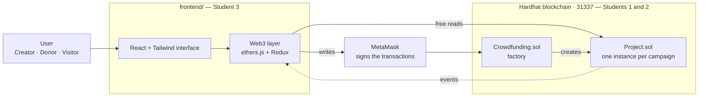
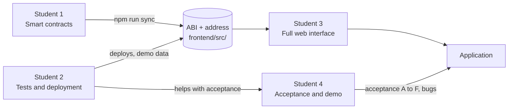
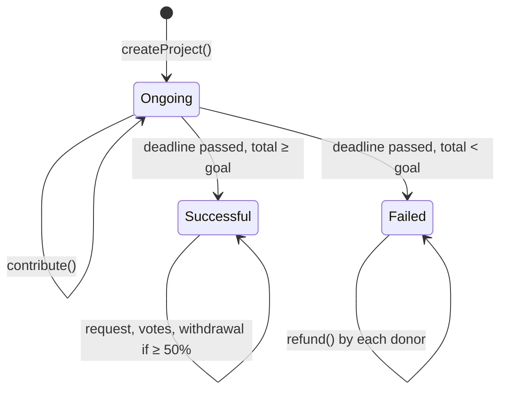

# Blockchain crowdfunding platform

**🌐 Language / Langue :** [English](README.en.md) · [Français](README.md)

A decentralized crowdfunding application. A creator launches a campaign with a **funding goal** and a **deadline**. The funds are held by a **Smart Contract** that records the creator and the donors. The creator can only withdraw the money after a favorable vote from the donors, and every donor is refunded if the goal is not reached.

**Stack:** Solidity 0.8.24 · Hardhat · Hardhat Ignition · ethers.js v6 · React · Redux Toolkit · Tailwind CSS · MetaMask
**Network:** local Hardhat (`http://127.0.0.1:8545`, chain `31337`)
**Team:** 4 students

---

## Roadmap

| Phase | Content | Owner | Status |
| --- | --- | --- | --- |
| 1 | Smart contracts and security | Student 1 | ✅ Done |
| 2 | Full web interface (React, Tailwind, MetaMask, ethers.js, Redux) | Student 3 | ✅ Done |
| 2 | Tests, deployment, demo data | Student 2 | ✅ Done |
| 2 | Acceptance testing, multi-PC, MetaMask guide, demo preparation | Student 4 | 🟡 Manual acceptance still to run |
| 3 | Report, presentation, demo rehearsal | **All** | ⏳ To do |


## Table of contents

0. [First steps: install and clone (each member)](#0-first-steps-install-and-clone-each-member)
1. [Architecture](#1-architecture)
2. [Work distribution](#2-work-distribution)
3. [Campaign life cycle](#3-campaign-life-cycle)
4. [Phase 1 — Smart contracts (done)](#4-phase-1--smart-contracts-done)
5. [Phase 2 — Tasks per student](#5-phase-2--tasks-per-student)
6. [Phase 3 — Report and presentation](#6-phase-3--report-and-presentation)
7. [Useful commands](#7-useful-commands)
8. [Git rules](#8-git-rules)
9. [Documentation](#9-documentation)

---

## 0. First steps: install and clone (each member)

These steps take about 10 minutes. Each member does them **once** on their own computer, before starting their task.

**Prerequisites:** Git, Node.js 18 or later (LTS) and the MetaMask browser extension.

### Step 1 — Accept the invitation and clone the repository

1. Open the GitHub invitation e-mail (or [github.com/notifications](https://github.com/notifications)) and click **Accept invitation**.
2. Clone the repository and enter the folder:

```bash
git clone https://github.com/Chaksterr/plateforme-crowdfunding-blockchain.git
cd plateforme-crowdfunding-blockchain
```

> On your first `git push`, GitHub asks for credentials: use your username and a **token** ([create a token](https://github.com/settings/tokens), check `repo`), not your password.

### Step 2 — Install dependencies and verify

```bash
npm install     # installs Hardhat and the tooling (1 to 3 minutes)
npm test        # should print: 47 passing
```

If you see `47 passing`, your environment is ready.

### Step 3 — Start the local blockchain and deploy

You need **two terminals** open in the project folder:

```bash
# Terminal 1: the local blockchain. Keep this terminal open the whole time.
npm run node

# Terminal 2
npm run deploy    # deploys the factory; expected address: 0x5FbDB2315678afecb367f032d93F642f64180aa3
npm run sync      # copies the ABI and address into frontend/src/
```

### Step 4 — Configure MetaMask

1. Add the network: **Settings → Networks → Add network manually**
   - Name: `Hardhat Local`
   - RPC URL: `http://127.0.0.1:8545`
   - Chain ID: `31337`
   - Currency: `ETH`
2. Import at least 3 test accounts (Creator, Donor 1, Donor 2) using the private keys printed by terminal 1 (`npm run node`). Each has 10,000 test ETH.
3. **After each restart of `npm run node`**: MetaMask → Settings → Advanced → **Clear activity and nonce data**, otherwise transactions are stuck ("nonce too high").

Detailed guide: [docs/commun/GUIDE_METAMASK_HARDHAT.md](docs/commun/GUIDE_METAMASK_HARDHAT.md) (French).

> ⚠️ These test keys are public. Never use them outside the local network, and never use your real MetaMask wallet for this project: use a separate browser profile if needed.

### Step 5 — Start your task

```bash
git checkout main && git pull           # get the latest version
git checkout -b feat/name-of-the-task   # create your branch (see section 8)
```

Then follow your checklist in [section 5](#5-phase-2--tasks-per-student).

---

## 1. Architecture



| Ref. | Feature | Contract function |
| --- | --- | --- |
| F1 | Create a campaign (goal, duration, minimum donation, title, description) | `Crowdfunding.createProject()` |
| F2 | Donate before the deadline, amount ≥ minimum | `Project.contribute()` |
| F3 | View: goal, deadline, total, donors, time left, state | `getStatus()`, `timeLeft()`, `getDonors()` |
| F4 | Request a withdrawal (amount, reason, recipient) if the campaign succeeds | `createWithdrawRequest()` |
| F5 | Vote, then withdraw if at least 50% of donors approve | `voteWithdrawRequest()`, `withdrawRequestedAmount()` |
| F6 | Get refunded if total < goal after the deadline | `refund()` |
| F7 | Web interface with MetaMask | `frontend/` (Phase 2) |

---

## 2. Work distribution



| Student | Role | Folders |
| --- | --- | --- |
| **1** | `Crowdfunding.sol` and `Project.sol` contracts, states, 50% vote, reentrancy-safe refund | `contracts/` |
| **2** | Mocha/Chai unit tests, Hardhat configuration, Ignition deployment, demo data | `test/`, `ignition/`, `scripts/` |
| **3** | **The whole web interface**: React + Tailwind project, pages and components, MetaMask connection, contract calls with ethers.js, global Redux state, events, error messages | `frontend/` |
| **4** | Acceptance of scenarios A to F, multi-PC test, team MetaMask guide, demo preparation and rehearsal | — |

Student 3 is the **only one who modifies `frontend/`**. The others report bugs through GitHub issues instead of changing the code directly.

The report and the presentation are written by all four.

---

## 3. Campaign life cycle



The state is not stored: `getStatus()` computes it from the clock and the total raised. It is therefore always accurate, and no transaction is needed to close a campaign.

---

## 4. Phase 1 — Smart contracts (done)

✅ **Verified**: 47 passing tests, 100% coverage (lines and branches), Ignition deployment and simulation OK.

📘 **Detailed phase explanation (French): [docs/etudiant1-smart-contracts/phase1.md](docs/etudiant1-smart-contracts/phase1.md)**

In short:
- **Two contracts**: `Crowdfunding.sol` (factory) creates one `Project.sol` per campaign. Each campaign keeps its own funds.
- **Creator and donors stored**: `creator` (fixed at creation), `contributions` (amount per donor) and `donors` (list of donors).
- **Frozen rules**: the goal, the minimum donation and the deadline are `immutable`.
- **Vote**: one voice per donor, withdrawal possible if `votes × 2 ≥ number of donors`.
- **Security**: reentrancy protection, creator-only access, double-vote prevention, transaction reverted if a transfer fails.

### Frozen ABI — reference for the frontend

| Contract | Write | Read | Events |
| --- | --- | --- | --- |
| `Crowdfunding` | `createProject(title, description, goal, minContribution, duration)` | `getProjects()`, `getProjectsCount()` | `ProjectCreated` |
| `Project` | `contribute()` *(payable)*, `createWithdrawRequest(amount, reason, recipient)`, `voteWithdrawRequest(id)`, `withdrawRequestedAmount(id)`, `refund()` | `creator`, `title`, `description`, `goal`, `minContribution`, `deadline`, `totalRaised`, `contributions(addr)`, `getDonors()`, `getStatus()` *(0 Ongoing, 1 Failed, 2 Successful)*, `timeLeft()`, `withdrawRequests(id)`, `getWithdrawRequestsCount()`, `hasVoted(id, addr)` | `DonationReceived`, `WithdrawRequestCreated`, `WithdrawVote`, `FundsWithdrawn`, `Refunded` |

Amounts are in **wei** (`ethers.parseEther` / `formatEther`) and durations in **seconds**.

### Still to do (Student 1)

- [ ] Create the GitHub repository and push `main`
- [ ] Invite the 3 collaborators (Settings → Collaborators)
- [ ] Protect `main` (Settings → Branches: require a Pull Request)

---

## 5. Phase 2 — Tasks per student

Student 3 builds the whole web interface. Student 2 prepares the demo data for them. Student 4 prepares the acceptance test sheet, then tests every feature as soon as it is merged.

Before starting, everyone has finished [section 0](#0-first-steps-install-and-clone-each-member) and sees `47 passing`.

### Order of work

| Step | Student 3 — Web interface | Student 2 — Tests and deployment | Student 4 — Acceptance and demo |
| --- | --- | --- | --- |
| **1. Kick-off** | Read [phase1.md](docs/etudiant1-smart-contracts/phase1.md) (sections 5 and 11), create the Vite + Tailwind + ethers + Redux project | Review the tests, `npm run coverage` | Team MetaMask guide (4 accounts), check that the 4 PCs are ready |
| **2. First pages** | MetaMask connection, reading campaigns, Home page, Create page | `scripts/seedDemo.js` + `npm run seed`: Student 3 gets campaigns to display | Write the acceptance sheet (exact steps, accounts, amounts for A to F) |
| **3. Features** | Detail page, Donate, withdraw requests, Vote, Withdraw, Refund, events, toasts | `frontend/.env.example`, deployment doc, then help with acceptance | Test every merged feature, open one issue per bug |
| **4. Validation** | Fix reported bugs, mobile display | Acceptance with Student 4 | **Full acceptance A to F**, multi-PC test, screenshots for the report |

Student 3 merges **progressively** (one PR per page or feature) so Student 4 can test without waiting for everything to be finished.

### Student 3 — Full web interface

**Setup**
- [x] Create the project: Vite + Tailwind + `ethers` + `@reduxjs/toolkit` + `react-redux` (keeping `src/abi/` and `src/deployed.json`)

**Web3 layer** (`frontend/src/web3/`)
- [x] `provider.js`: `BrowserProvider(window.ethereum)` to write, `JsonRpcProvider(import.meta.env.VITE_RPC_URL ?? "http://127.0.0.1:8545")` to read without a wallet
- [x] Verify chain 31337, offer `wallet_switchEthereumChain` / `wallet_addEthereumChain`
- [x] React to `accountsChanged` and `chainChanged`
- [x] `contracts.js`: instances created from `src/abi/*.json` and `src/deployed.json`
- [x] Functions: `loadProjects()`, `loadProject(addr)`, `createProject()`, `donate()`, `createRequest()`, `vote()`, `withdraw()`, `refund()`
- [x] Translate contract errors into readable messages (list in [phase1.md](docs/etudiant1-smart-contracts/phase1.md#53-les-fonctions-une-par-une), French)

**Global state** (`frontend/src/store/`)
- [x] Redux store: `walletSlice` (account, chain), project data in hooks
- [x] Event listening (`DonationReceived`, `WithdrawVote`…) → automatic refresh

**Pages and components** (`frontend/src/pages/`, `frontend/src/components/`)
- [x] Top bar: "Connecter MetaMask" button, address and balance of the account
- [x] **Home** page: campaign cards (title, goal, total, progress bar, time left, state)
- [x] **Create a campaign** page (F1): title, description, goal (ETH), minimum donation (ETH), duration (minutes)
- [x] **Detail** page (F3): information, donor list, history
- [x] **Donate** button (F2) with an amount field
- [x] **Withdraw requests** section: form (creator, if Successful), list with a vote bar, **Vote** and **Withdraw** buttons (F4, F5)
- [x] **Refund** button (F6) for a donor if the campaign failed
- [x] Success / error messages (toasts) and loading states
- [x] Correct display on phone and desktop

### Student 2 — Tests and deployment

- [x] Review the existing tests (`test/`), run `npm run coverage`, complete if needed
- [x] Script `scripts/seedDemo.js` (+ `npm run seed`): 3 campaigns with donations — one ongoing, one that succeeds and one that fails. **Delivered first**, so Student 3 has data to display
- [x] File `frontend/.env.example` with `VITE_RPC_URL=http://127.0.0.1:8545`
- [x] Document the deployment (node, deploy, seed, sync): this text feeds the report chapter
- [ ] Help Student 4 with the full acceptance (step 4)

### Student 4 — Acceptance and demo

- [ ] Team MetaMask guide: network 31337, import of 4 accounts (Creator, Donors 1/2/3), "Clear activity and nonce data" after each node restart (base: [docs/commun/GUIDE_METAMASK_HARDHAT.md](docs/commun/GUIDE_METAMASK_HARDHAT.md))
- [x] Acceptance sheet: for each scenario, the accounts, the amounts and the exact click order ([docs/commun/RECETTE.md](docs/commun/RECETTE.md))
- [ ] Test every feature as soon as it is merged, open one GitHub issue per bug (steps to reproduce + screenshot)
- [ ] **Multi-PC mode**: `npx hardhat node --hostname 0.0.0.0` + `npm run dev -- --host`, test from a 2nd PC
- [ ] Full acceptance of the scenarios below
- [ ] Screenshots of every page (desktop and mobile) for the report
- [x] Demo script in `docs/commun/presentation/DEMO_SCENARIO.md`

| # | Scenario | Expected result | OK? |
| --- | --- | --- | --- |
| A | Goal 5 ETH, 3 donations of 2 ETH, end, 4 ETH request, 2 votes out of 3, withdrawal | Successful, recipient +4 ETH | [ ] |
| B | Goal 50 ETH, donations of 1 and 2 ETH, end, refunds | Failed, everyone gets their money back, contract at 0 | [ ] |
| C | Donation below the minimum / after the end | Rejected with a clear message | [ ] |
| D | Withdrawal with 1 vote out of 3 | Rejected | [ ] |
| E | Double vote, double refund, withdrawal by a non-creator | Rejected | [ ] |
| F | Browser without MetaMask | Read-only OK, action buttons hidden | [ ] |

Everyone then writes their report chapter in `docs/commun/rapport/` (see [Phase 3](#6-phase-3--report-and-presentation)).

**End-of-Phase 2 check:** scenarios A and B run entirely in the browser.

---

## 6. Phase 3 — Report and presentation

**All together.** Each member writes the part they coded, then everything is assembled and reviewed by the four.

| Report chapter | Content | Writer |
| --- | --- | --- |
| Introduction and context | Classic crowdfunding vs smart contract, blockchain, Ethereum, gas, wallet | All |
| Specifications | Actors, F1–F7, RG1–RG5, deliberate deviations | Student 1 |
| Smart contracts and security | Factory, states, 50% vote, reentrancy | Student 1 |
| Tests and deployment | Mocha/Chai, coverage, Ignition, demo data | Student 2 |
| Web interface | Pages, MetaMask, ethers, Redux, events, responsive | Student 3 |
| Acceptance and validation | Scenarios A to F, multi-PC, screenshots, bugs fixed | Student 4 |
| Conclusion | Wrap-up, limits, perspectives (Sepolia, weighted vote, IPFS) | All |

To mention in the report:
- the deliberate deviations from the specification (computed state, duration instead of a date, factory): see [phase1.md](docs/etudiant1-smart-contracts/phase1.md), section 10 (French);
- the work distribution was adjusted during the project (a single person on the whole web interface).

| Presentation block (~15 min) | Duration | Who |
| --- | --- | --- |
| Problem, goals, architecture | 3 min | Student 4 |
| Smart contracts and security | 3 min | Student 1 |
| Live tests (`npm test`), deployment | 2 min | Student 2 |
| Demo scenario A (success, vote, withdrawal) | 4 min | Student 3 |
| Demo scenario B (failure, refund) | 2 min | Student 4 |
| Conclusion, questions | 1 min | All |

- [ ] Full report, reviewed by the 4, exported as PDF
- [ ] Slides finished ([docs/commun/presentation/PRESENTATION.md](docs/commun/presentation/PRESENTATION.md))
- [ ] Demo rehearsed twice + backup video recorded (Drive link if over 50 MB, do not commit it)
- [ ] `v1.0` tag on GitHub

---

## 7. Useful commands

```bash
npm install                 # once only (see section 0)
npm test                    # 47 tests
npm run coverage            # coverage report

npm run node                # terminal 1: local blockchain (keep open)
npm run deploy              # terminal 2: deploys the factory
npm run sync                # copies the ABI and address into frontend/src
npm run seed                # demo data: 3 campaigns (ongoing, successful, failed)
npm run simulate            # replays scenarios A and B without the interface
SECONDS=120 npm run ff      # moves the clock forward by 120 s
npm run deploy:reset        # redeploys after a node restart
```

```
contracts/          Crowdfunding.sol, Project.sol (+ contracts/test/: attack contracts for the tests)
test/               Mocha/Chai tests
ignition/modules/   Hardhat Ignition deployment
scripts/            simulate, fastForward (ff), syncAbi (sync), seedDemo (seed)
frontend/src/       React app (Vite): pages, components, web3 layer + abi/ and deployed.json
docs/               commun/ (specification, report, presentation) + etudiant1-smart-contracts/
```

---

## 8. Git rules

1. `git checkout main && git pull`
2. `git checkout -b feat/my-task`
3. Commit, then `git push -u origin feat/my-task`
4. Open a Pull Request → review by another member → "Squash and merge"
5. Before the PR, check that `npm test` still passes

---

## 9. Documentation

The tasks and deliverables of each student are in this README (sections 4 to 6). The report goes in `docs/commun/rapport/` and the presentation in `docs/commun/presentation/`.

| Document | For whom | Content |
| --- | --- | --- |
| [docs/commun/CahierDesCharges.pdf](docs/commun/CahierDesCharges.pdf) | All | Official specification (French) |
| [docs/etudiant1-smart-contracts/phase1.md](docs/etudiant1-smart-contracts/phase1.md) | All, report | Phase 1 explained in detail: design, each function, error messages, security, tests, deployment (French) |
| [docs/commun/GUIDE_METAMASK_HARDHAT.md](docs/commun/GUIDE_METAMASK_HARDHAT.md) | Students 2, 3, 4 | Run the blockchain, configure MetaMask, ethers.js examples (French) |
| [docs/commun/GUIDE_DEPLOIEMENT.md](docs/commun/GUIDE_DEPLOIEMENT.md) | All | Full local deployment guide: node, deploy, seed, frontend, troubleshooting (French) |
| [docs/commun/RECETTE.md](docs/commun/RECETTE.md) | Student 4 | Acceptance testing of scenarios A to F, multi-PC, exit checklist (French) |
| [docs/commun/rapport/RAPPORT.md](docs/commun/rapport/RAPPORT.md) | All | Project report (French) |
| [docs/commun/presentation/PRESENTATION.md](docs/commun/presentation/PRESENTATION.md) | All | Slide deck and demo script (French) |
