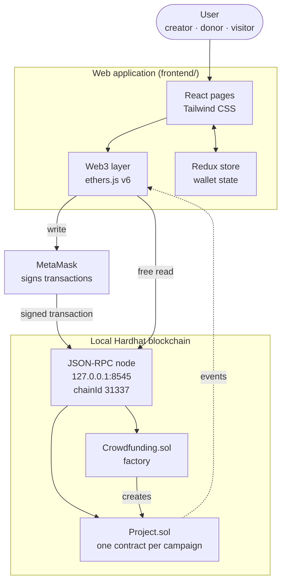
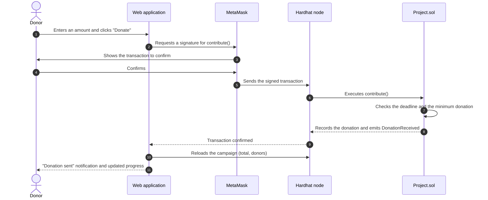
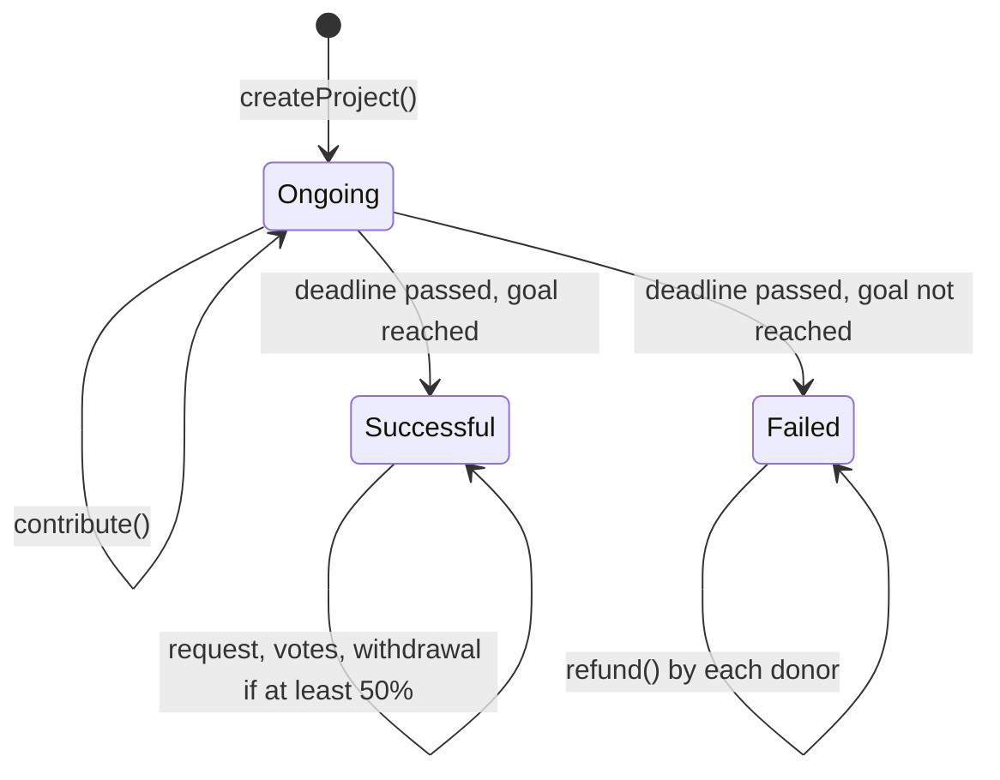

# Blockchain crowdfunding platform

**🌐 Language / Langue :** English · [Français](README.md)

A decentralized crowdfunding application (DApp) on Ethereum: funds are held by a smart contract, released by a donor vote, and returned to donors if the goal is not reached.

## Contents

1. [Introduction](#1-introduction)
2. [General architecture](#2-general-architecture)
3. [Tools used](#3-tools-used)
4. [Project tree](#4-project-tree)
5. [Features](#5-features)
6. [Installation](#6-installation)
7. [Team members](#7-team-members)

---

## 1. Introduction

On a classic crowdfunding platform, donors' money is entrusted to an intermediary. The intermediary decides when the creator receives the funds and whether donors get refunded if the campaign fails: you have to trust it.

This project replaces that intermediary with Ethereum **smart contracts**. A creator launches a campaign with a **goal**, a **minimum donation** and a **duration**. Donors send ETH, which stays locked in the campaign's contract until the deadline. Then:

- **goal reached**: the creator can withdraw the funds, but only for requests approved by at least **50% of the donors**;
- **goal not reached**: every donor gets back **exactly what they gave**.

The rules are written in the code and cannot be changed after deployment, neither by the creator nor by the team. The application runs on a local Ethereum blockchain (Hardhat) and is used from the browser with MetaMask.

| | Classic crowdfunding | This project |
| --- | --- | --- |
| Who holds the money? | An intermediary | The campaign's contract |
| Who sets the rules? | The platform, which can change them | The code, fixed at deployment |
| Who releases the funds? | The platform | At least 50% of the donors, by vote |
| Refund if the campaign fails | Depends on the platform's policy | Guaranteed: each donor claims their money back from the contract |

---

## 2. General architecture

The project is built from two smart contracts deployed on a local blockchain, a React web application, and MetaMask, which signs the user's transactions.



| Component | Role |
| --- | --- |
| `Crowdfunding.sol` | The **factory**: creates a `Project` contract for each new campaign and keeps the list of all campaigns. |
| `Project.sol` | One **campaign**: holds its own funds, records the creator and the donors, and handles withdrawal requests, votes and refunds. |
| Hardhat node | Local Ethereum blockchain, with 20 test accounts funded with 10,000 ETH each. |
| MetaMask | Browser wallet: signs every transaction (create, donate, vote, withdraw, refund). |
| Web application | Reads campaigns directly from the node, even without MetaMask, and goes through MetaMask for every write. |

Design principles:

- **One contract per campaign**: each campaign's funds are kept separate from the others.
- **Free reads, signed writes**: viewing a campaign costs nothing and needs no wallet; every action is a transaction signed in MetaMask.
- **Computed state, not stored**: `getStatus()` derives the campaign's state from the current time and the total raised. No transaction is needed to close a campaign.
- **Live updates**: every action emits an event (`DonationReceived`, `WithdrawVote`…) that the application listens to so it refreshes on its own.
- **Link between contracts and interface**: after deployment, `npm run sync` copies the ABIs and the factory address into `frontend/src/`.

### How a donation flows



---

## 3. Tools used

| Area | Tool | Version | Used for |
| --- | --- | --- | --- |
| **Smart contracts** | Solidity | 0.8.24 | Contract language |
| | Hardhat + Hardhat Toolbox | 2.29 / 5.0 | Compilation, local blockchain, running tests and scripts |
| | Hardhat Ignition | 0.15 | Deploying the factory |
| **Tests** | Mocha + Chai | 11 / 4 | Contract tests |
| | solidity-coverage | 0.8 | Contract code coverage |
| | Vitest + Testing Library + jsdom | 2.1 / 16 / 25 | Web application tests |
| **Frontend** | React | 18.3 | User interface |
| | Vite | 5.4 | Dev server and build |
| | Tailwind CSS | 3.4 | Styling |
| | Redux Toolkit + React Redux | 2.14 / 9.3 | Global state (connected wallet) |
| | React Router | 6.30 | Navigation between pages |
| | ethers.js | 6.17 | Reading contracts and sending transactions |
| **Wallet** | MetaMask | extension | Signing transactions |
| **Quality** | GitHub Actions | | Continuous integration: compile, test, coverage, build |
| | Git `pre-commit` hook | | Compile, tests and checks before every commit |
| **Environment** | Node.js + npm | 18 or later | Running all the tools |

---

## 4. Project tree

```text
plateforme-crowdfunding-blockchain/
├── contracts/
│   ├── Crowdfunding.sol               # factory: creates and lists campaigns
│   ├── Project.sol                    # one campaign: funds, votes, refunds
│   └── test/
│       └── ReentrancyAttacker.sol     # malicious contract used by the tests
├── test/                              # contract tests (Mocha + Chai)
│   ├── Crowdfunding.js                # factory and deployment module
│   ├── Project.js                     # every campaign function, security
│   ├── ProjectBoundaries.js           # boundary values and invariants
│   └── Lifecycle.js                   # full end-to-end scenarios
├── ignition/modules/
│   └── Crowdfunding.js                # Hardhat Ignition deployment
├── scripts/
│   ├── syncAbi.js                     # copies the ABIs and address to frontend/src
│   ├── seedDemo.js                    # creates 3 demo campaigns
│   ├── simulate.js                    # replays scenarios A and B in the terminal
│   ├── fastForward.js                 # moves the local blockchain clock forward
│   └── precommit.sh                   # checks run before every commit
├── frontend/                          # web application (React + Vite)
│   ├── index.html
│   ├── vite.config.js                 # Vite and Vitest configuration
│   ├── tailwind.config.js
│   ├── .env.example                   # VITE_RPC_URL, VITE_FACTORY_ADDRESS
│   └── src/
│       ├── main.jsx                   # entry point: Redux, router, error boundary
│       ├── App.jsx                    # page routes
│       ├── config.js                  # network, RPC URL, factory address
│       ├── deployed.json              # factory address (npm run sync)
│       ├── abi/                       # contract ABIs (npm run sync)
│       ├── web3/                      # ethers.js: reads, transactions, errors
│       ├── store/                     # Redux store (wallet)
│       ├── hooks/                     # useWallet, useTransaction, useChainEvents…
│       ├── components/                # header, cards, progress bars, notifications
│       └── pages/                     # Home, Create, Details, My contributions
├── docs/
│   ├── commun/
│   │   ├── CahierDesCharges.pdf       # project specification
│   │   ├── GUIDE_DEPLOIEMENT.md       # detailed local deployment, troubleshooting
│   │   ├── GUIDE_METAMASK_HARDHAT.md  # MetaMask setup
│   │   ├── RECETTE.md                 # manual test scenarios A to F
│   │   ├── rapport/                   # project report
│   │   └── presentation/              # slides and demo script
│   └── etudiant1-smart-contracts/
│       └── phase1.md                  # smart contracts explained in detail
├── .github/workflows/ci.yml           # continuous integration (GitHub Actions)
├── .githooks/pre-commit               # runs scripts/precommit.sh
├── hardhat.config.js                  # Solidity 0.8.24, localhost network (31337)
├── .solcover.js                       # coverage configuration
├── package.json                       # project npm scripts
├── README.md
└── README.en.md
```

Frontend tests (`*.test.js`, `*.test.jsx`) sit next to the files they test. The documentation in `docs/` is written in French.

---

## 5. Features

### Main features

| Ref. | Feature | Actor | Contract function |
| --- | --- | --- | --- |
| F1 | Create a campaign: title, description, goal, minimum donation, duration | Creator | `Crowdfunding.createProject()` |
| F2 | Donate ETH before the deadline, at least the minimum donation | Donor | `Project.contribute()` |
| F3 | View a campaign: goal, total raised, donors, time left, state | Everyone | `getStatus()`, `timeLeft()`, `getDonors()` |
| F4 | Request a withdrawal (amount, reason, recipient) after a successful campaign | Creator | `createWithdrawRequest()` |
| F5 | Vote on a request, then withdraw the funds if at least 50% of the donors approved it | Donors, then creator | `voteWithdrawRequest()`, `withdrawRequestedAmount()` |
| F6 | Get your money back if the goal is not reached by the deadline | Donor | `refund()` |
| F7 | Use all of these features from a web interface connected to MetaMask | Everyone | `frontend/` |

### Campaign lifecycle



The state is never stored: `getStatus()` recomputes it on every read from the current time and the total raised.

### Business rules

| Rule | Description |
| --- | --- |
| RG1 | The goal, minimum donation and duration must be greater than 0, so the deadline is always in the future. |
| RG2 | No donation is accepted after the deadline or below the minimum donation. |
| RG3 | Funds stay locked in the contract until the deadline. |
| RG4 | A withdrawal is executed only if at least 50% of the donors approved it (one vote per donor). |
| RG5 | Each donor gets back exactly their contribution, only once. |

### Security

- **Reentrancy protection**: the contribution is reset to zero, or the request marked as executed, **before** the ETH is sent.
- **Access control**: only the creator can request and execute a withdrawal; only donors can vote.
- **No double actions**: one vote per donor per request, one refund per donor, one execution per request.
- **Failed transfer, reverted transaction**: if sending ETH fails, nothing is changed.
- **Fixed rules**: the creator, goal, minimum donation and deadline are `immutable`.

### Web interface

- **Home**: every campaign with its progress bar, time left and state; filters (ongoing, successful, failed) and sorting (recent, amount raised, time left).
- **Create a campaign**: a form that checks the fields before sending.
- **Campaign details**: donation with suggested amounts, donor list, withdrawal requests with a vote bar. The available actions (donate, request a withdrawal, vote, withdraw, get a refund) depend on the campaign's state and the connected account's role.
- **My contributions**: the campaigns supported by the connected account and the total given.
- **Without MetaMask**: campaigns can still be viewed in read-only mode.
- **Right network**: detects a wrong network and offers a button to switch to Hardhat Local (31337).
- **Clear feedback**: a transaction preview before signing, success or failure notifications, and contract errors translated into plain French.
- **Responsive**: works on phones and computers.

The interface is in French.

---

## 6. Installation

### Prerequisites

- [Git](https://git-scm.com/)
- [Node.js](https://nodejs.org/) 18 or later (LTS recommended), with npm
- The [MetaMask](https://metamask.io/) browser extension

### Step 1 — Clone the repository

```bash
git clone https://github.com/Chaksterr/plateforme-crowdfunding-blockchain.git
cd plateforme-crowdfunding-blockchain
```

### Step 2 — Install the dependencies and check

```bash
npm install     # Hardhat and the contract tooling
npm test        # should print: 82 passing
```

### Step 3 — Start the local blockchain (terminal 1)

```bash
npm run node
```

Keep this terminal open. It prints 20 test accounts, each funded with 10,000 ETH, with their private keys.

### Step 4 — Deploy the contracts (terminal 2)

```bash
npm run deploy  # deploys the factory: 0x5FbDB2315678afecb367f032d93F642f64180aa3
npm run sync    # copies the ABIs and the address into frontend/src
npm run seed    # optional: 3 demo campaigns (ongoing, successful, failed)
```

### Step 5 — Start the web application (terminal 2)

```bash
cd frontend
npm install
npm run dev     # http://localhost:5173
```

### Step 6 — Set up MetaMask

1. Add the network: **Settings → Networks → Add a network manually**
   - Name: `Hardhat Local`
   - RPC URL: `http://127.0.0.1:8545`
   - Chain ID: `31337`
   - Symbol: `ETH`
2. Import a few test accounts using the private keys printed in terminal 1. `npm run seed` uses account #0 as the creator and accounts #1 to #3 as donors.
3. Open <http://localhost:5173> and click **Connecter MetaMask** (Connect MetaMask).

> ⚠️ These test keys are public. Never use them on a real network and never send real funds to these addresses.

> 🔁 After every restart of `npm run node`: run `npm run deploy:reset` again (then `npm run seed` if needed), and in MetaMask choose **Settings → Advanced → Clear activity tab data**, otherwise transactions get stuck ("nonce too high").

### Useful commands

| Command | What it does |
| --- | --- |
| `npm run coverage` | Contract coverage report |
| `npm run simulate` | Replays scenarios A (success) and B (failure) in the terminal |
| `SECONDS=120 npm run ff` | Moves the blockchain clock forward by 120 seconds, for example to end a campaign |
| `npm run deploy:reset` | Redeploys the factory after a node restart |
| `npm test` (in `frontend/`) | Web application tests: 191 tests |
| `npm run build` (in `frontend/`) | Production build |

Detailed guide (multi-PC, troubleshooting, in French): [docs/commun/GUIDE_DEPLOIEMENT.md](docs/commun/GUIDE_DEPLOIEMENT.md).

---

## 7. Team members

- Yessine Abdelmaksoud
- Mohamed Ali Abid
- Ahmad Chakcha
- Mohamed Ali Djemal
