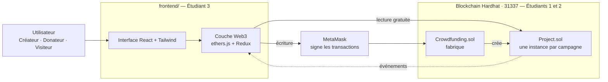
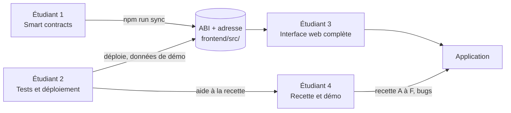
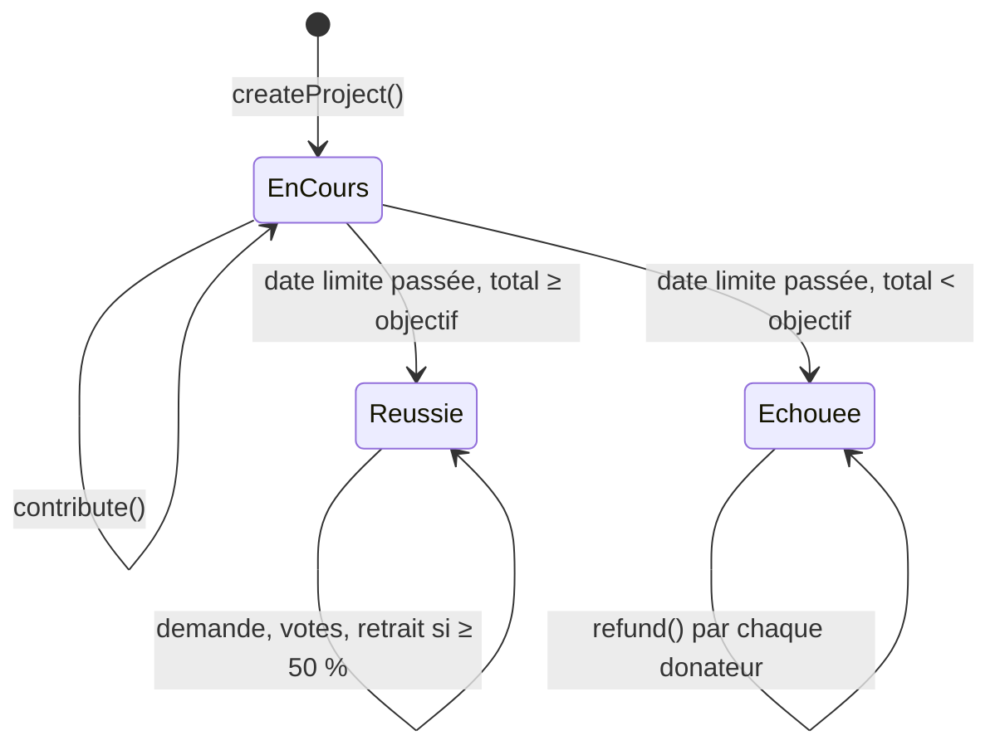

# Plateforme de financement participatif sur blockchain

Application décentralisée de financement participatif. Un créateur lance une campagne avec un **objectif de montant** et une **date limite**. Les fonds sont gardés par un **Smart Contract** qui enregistre le créateur et les donateurs. Le créateur ne peut retirer l'argent qu'après un vote favorable des donateurs, et chaque donateur est remboursé si l'objectif n'est pas atteint.

**Stack :** Solidity 0.8.24 · Hardhat · Hardhat Ignition · ethers.js v6 · React · Redux Toolkit · Tailwind CSS · MetaMask
**Réseau :** Hardhat local (`http://127.0.0.1:8545`, chaîne `31337`)
**Équipe :** 4 étudiants

---

## Roadmap

| Phase | Contenu | Responsable | État |
| --- | --- | --- | --- |
| 1 | Smart contracts et sécurité | Étudiant 1 | ✅ Terminé |
| 2 | Interface web complète (React, Tailwind, MetaMask, ethers.js, Redux) | Étudiant 3 | ⏳ À faire |
| 2 | Tests, déploiement, données de démo | Étudiant 2 | ⏳ À faire |
| 2 | Recette, multi-PC, guide MetaMask, préparation de la démo | Étudiant 4 | ⏳ À faire |
| 3 | Rapport, présentation, répétition de la démo | **Tous** | ⏳ À faire |


## Sommaire

0. [Premiers pas : installer et cloner (à faire par chacun)](#0-premiers-pas--installer-et-cloner-à-faire-par-chacun)
1. [Architecture](#1-architecture)
2. [Répartition du travail](#2-répartition-du-travail)
3. [Cycle de vie d'une campagne](#3-cycle-de-vie-dune-campagne)
4. [Phase 1 — Smart contracts (terminée)](#4-phase-1--smart-contracts-terminée)
5. [Phase 2 — Tâches par étudiant](#5-phase-2--tâches-par-étudiant)
6. [Phase 3 — Rapport et présentation](#6-phase-3--rapport-et-présentation)
7. [Commandes utiles](#7-commandes-utiles)
8. [Règles Git](#8-règles-git)
9. [Documentation](#9-documentation)

---

## 0. Premiers pas : installer et cloner (à faire par chacun)

Ces étapes prennent environ 10 minutes. Chaque membre les fait **une seule fois** sur son ordinateur, avant de commencer sa tâche.

**Prérequis :** Git, Node.js 18 ou plus (version LTS) et l'extension MetaMask dans le navigateur.

### Étape 1 — Accepter l'invitation et cloner le dépôt

1. Ouvrir l'e-mail d'invitation GitHub (ou [github.com/notifications](https://github.com/notifications)) et cliquer sur **Accept invitation**.
2. Cloner le dépôt et entrer dans le dossier :

```bash
git clone https://github.com/Chaksterr/plateforme-crowdfunding-blockchain.git
cd plateforme-crowdfunding-blockchain
```

> Au premier `git push`, GitHub demande un identifiant : utilisez votre nom d'utilisateur et un **token** ([créer un token](https://github.com/settings/tokens), cocher `repo`), pas votre mot de passe.

### Étape 2 — Installer les dépendances et vérifier

```bash
npm install     # installe Hardhat et les outils (1 à 3 minutes)
npm test        # doit afficher : 47 passing
```

Si `47 passing` s'affiche, votre environnement est prêt.

### Étape 3 — Lancer la blockchain locale et déployer

Il faut **deux terminaux** ouverts dans le dossier du projet :

```bash
# Terminal 1 : la blockchain locale. Laisser ce terminal ouvert pendant tout le travail.
npm run node

# Terminal 2
npm run deploy    # déploie la fabrique ; adresse attendue : 0x5FbDB2315678afecb367f032d93F642f64180aa3
npm run sync      # copie l'ABI et l'adresse dans frontend/src/
```

### Étape 4 — Configurer MetaMask

1. Ajouter le réseau : **Paramètres → Réseaux → Ajouter un réseau manuellement**
   - Nom : `Hardhat Local`
   - URL RPC : `http://127.0.0.1:8545`
   - ID de chaîne : `31337`
   - Symbole : `ETH`
2. Importer au moins 3 comptes de test (Créateur, Donateur 1, Donateur 2) avec les clés privées affichées dans le terminal 1 (`npm run node`). Chacun a 10 000 ETH de test.
3. **Après chaque redémarrage de `npm run node`** : MetaMask → Paramètres → Avancé → **Effacer les données d'activité**, sinon les transactions sont bloquées (« nonce too high »).

Guide détaillé : [docs/commun/GUIDE_METAMASK_HARDHAT.md](docs/commun/GUIDE_METAMASK_HARDHAT.md).

> ⚠️ Ces clés de test sont publiques. Ne les utilisez jamais en dehors du réseau local, et n'utilisez jamais votre vrai portefeuille MetaMask pour ce projet : créez un profil de navigateur séparé si besoin.

### Étape 5 — Commencer sa tâche

```bash
git checkout main && git pull           # récupérer la dernière version
git checkout -b feat/nom-de-la-tache    # créer sa branche (voir section 8)
```

Puis suivre sa checklist dans la [section 5](#5-phase-2--tâches-par-étudiant).

---

## 1. Architecture



| Réf. | Fonctionnalité | Fonction du contrat |
| --- | --- | --- |
| F1 | Créer une campagne (objectif, durée, don minimum, titre, description) | `Crowdfunding.createProject()` |
| F2 | Donner avant la date limite, montant ≥ minimum | `Project.contribute()` |
| F3 | Consulter : objectif, date limite, total, donateurs, temps restant, état | `getStatus()`, `timeLeft()`, `getDonors()` |
| F4 | Demander un retrait (montant, motif, destinataire) si la campagne réussit | `createWithdrawRequest()` |
| F5 | Voter, puis retirer si au moins 50 % des donateurs approuvent | `voteWithdrawRequest()`, `withdrawRequestedAmount()` |
| F6 | Se faire rembourser si total < objectif après la date limite | `refund()` |
| F7 | Interface web avec MetaMask | `frontend/` (Phase 2) |

---

## 2. Répartition du travail



| Étudiant | Rôle | Dossiers |
| --- | --- | --- |
| **1** | Contrats `Crowdfunding.sol` et `Project.sol`, statuts, vote à 50 %, remboursement sécurisé contre la réentrance | `contracts/` |
| **2** | Tests unitaires Mocha/Chai, configuration Hardhat, déploiement Ignition, données de démo | `test/`, `ignition/`, `scripts/` |
| **3** | **Toute l'interface web** : projet React + Tailwind, pages et composants, connexion MetaMask, appels au contrat avec ethers.js, état global Redux, événements, messages d'erreur | `frontend/` |
| **4** | Recette des scénarios A à F, test multi-PC, guide MetaMask de l'équipe, préparation et répétition de la démo | — |

L'Étudiant 3 est le **seul à modifier `frontend/`**. Les autres signalent les bugs par des issues GitHub au lieu de modifier son code directement.

Le rapport et la présentation sont rédigés par les quatre.

---

## 3. Cycle de vie d'une campagne



L'état n'est pas stocké : `getStatus()` le calcule à partir de l'heure et du total collecté. Il est donc toujours exact, sans qu'aucune transaction ne soit nécessaire pour clôturer une campagne.

---

## 4. Phase 1 — Smart contracts (terminée)

✅ **Vérifiée** : 47 tests réussis, couverture 100 % (lignes et branches), déploiement Ignition et simulation OK.

📘 **Explication détaillée de la phase : [docs/etudiant1-smart-contracts/phase1.md](docs/etudiant1-smart-contracts/phase1.md)**

En résumé :
- **Deux contrats** : `Crowdfunding.sol` (fabrique) crée un `Project.sol` par campagne. Chaque campagne garde ses propres fonds.
- **Créateur et donateurs stockés** : `creator` (fixé à la création), `contributions` (montant de chaque donateur) et `donors` (liste des donateurs).
- **Règles figées** : l'objectif, le don minimum et la date limite sont `immutable`.
- **Vote** : une voix par donateur, retrait possible si `votes × 2 ≥ nombre de donateurs`.
- **Sécurité** : protection contre la réentrance, accès réservé au créateur, anti double vote, transaction annulée si un virement échoue.

### ABI gelée — référence pour le frontend

| Contrat | Écriture | Lecture | Événements |
| --- | --- | --- | --- |
| `Crowdfunding` | `createProject(title, description, goal, minContribution, duration)` | `getProjects()`, `getProjectsCount()` | `ProjectCreated` |
| `Project` | `contribute()` *(payable)*, `createWithdrawRequest(amount, reason, recipient)`, `voteWithdrawRequest(id)`, `withdrawRequestedAmount(id)`, `refund()` | `creator`, `title`, `description`, `goal`, `minContribution`, `deadline`, `totalRaised`, `contributions(addr)`, `getDonors()`, `getStatus()` *(0 En cours, 1 Échouée, 2 Réussie)*, `timeLeft()`, `withdrawRequests(id)`, `getWithdrawRequestsCount()`, `hasVoted(id, addr)` | `DonationReceived`, `WithdrawRequestCreated`, `WithdrawVote`, `FundsWithdrawn`, `Refunded` |

Les montants sont en **wei** (`ethers.parseEther` / `formatEther`) et la durée en **secondes**.

### Reste à faire (Étudiant 1)

- [ ] Créer le dépôt sur GitHub et pousser `main`
- [ ] Inviter les 3 collaborateurs (Settings → Collaborators)
- [ ] Protéger `main` (Settings → Branches : Pull Request obligatoire)

---

## 5. Phase 2 — Tâches par étudiant

L'Étudiant 3 construit toute l'interface web. L'Étudiant 2 lui prépare les données de démo. L'Étudiant 4 prépare la recette, puis teste chaque fonctionnalité dès qu'elle est fusionnée.

Avant de commencer, chacun a terminé la [section 0](#0-premiers-pas--installer-et-cloner-à-faire-par-chacun) et voit `47 passing`.

### Ordre de travail

| Étape | Étudiant 3 — Interface web | Étudiant 2 — Tests et déploiement | Étudiant 4 — Recette et démo |
| --- | --- | --- | --- |
| **1. Démarrage** | Lire [phase1.md](docs/etudiant1-smart-contracts/phase1.md) (sections 5 et 11), créer le projet Vite + Tailwind + ethers + Redux | Relire les tests, `npm run coverage` | Guide MetaMask de l'équipe (4 comptes), vérifier que les 4 PC sont prêts |
| **2. Premières pages** | Connexion MetaMask, lecture des campagnes, page Accueil, page Créer | `scripts/seedDemo.js` + `npm run seed` : l'Étudiant 3 a ainsi des campagnes à afficher | Écrire la fiche de recette (étapes exactes, comptes, montants pour A à F) |
| **3. Fonctionnalités** | Page Détail, Donner, demandes de retrait, Voter, Retirer, Rembourser, événements, toasts | `frontend/.env.example`, doc de déploiement, puis aide à la recette | Tester chaque fonctionnalité fusionnée, ouvrir une issue par bug |
| **4. Validation** | Corriger les bugs signalés, affichage mobile | Recette avec l'Étudiant 4 | **Recette complète A à F**, test multi-PC, captures d'écran pour le rapport |

L'Étudiant 3 fusionne **petit à petit** (une PR par page ou par fonctionnalité), pour que l'Étudiant 4 puisse tester sans attendre que tout soit terminé.

### Étudiant 3 — Interface web complète

**Mise en place**
- [ ] Créer le projet : `npm create vite@latest frontend -- --template react` (conserver `src/abi/` et `src/deployed.json`)
- [ ] Installer Tailwind CSS, `ethers`, `@reduxjs/toolkit` et `react-redux`

**Couche Web3** (`frontend/src/web3/`)
- [ ] `provider.js` : `BrowserProvider(window.ethereum)` pour écrire, `JsonRpcProvider(import.meta.env.VITE_RPC_URL ?? "http://127.0.0.1:8545")` pour lire sans wallet
- [ ] Vérifier la chaîne 31337, proposer `wallet_switchEthereumChain` / `wallet_addEthereumChain`
- [ ] Réagir à `accountsChanged` et `chainChanged`
- [ ] `contracts.js` : instances créées depuis `src/abi/*.json` et `src/deployed.json`
- [ ] Fonctions : `loadProjects()`, `loadProject(addr)`, `createProject()`, `donate()`, `createRequest()`, `vote()`, `withdraw()`, `refund()`
- [ ] Traduire les erreurs du contrat en messages lisibles (liste dans [phase1.md](docs/etudiant1-smart-contracts/phase1.md#53-les-fonctions-une-par-une))

**État global** (`frontend/src/store/`)
- [ ] Store Redux : `walletSlice` (compte, chaîne), `projectsSlice` (liste + détail)
- [ ] Écoute des événements (`DonationReceived`, `WithdrawVote`…) → rafraîchissement automatique

**Pages et composants** (`frontend/src/pages/`, `frontend/src/components/`)
- [ ] Barre du haut : bouton « Connecter MetaMask », adresse et solde du compte
- [ ] Page **Accueil** : cartes des campagnes (titre, objectif, total, barre de progression, temps restant, état)
- [ ] Page **Créer une campagne** (F1) : titre, description, objectif (ETH), don minimum (ETH), durée (minutes)
- [ ] Page **Détail** (F3) : informations, liste des donateurs, historique
- [ ] Bouton **Donner** (F2) avec un champ montant
- [ ] Section **Demandes de retrait** : formulaire (créateur, si Réussie), liste avec barre de votes, boutons **Voter** et **Retirer** (F4, F5)
- [ ] Bouton **Rembourser** (F6) pour un donateur si la campagne a échoué
- [ ] Messages de succès / erreur (toast) et états de chargement
- [ ] Affichage correct sur téléphone et ordinateur

### Étudiant 2 — Tests et déploiement

- [ ] Relire les tests existants (`test/`), lancer `npm run coverage`, compléter si besoin
- [ ] Script `scripts/seedDemo.js` (+ `npm run seed`) : 2 campagnes avec des dons, une qui réussira et une qui échouera. **À livrer en premier**, pour que l'Étudiant 3 ait des données à afficher
- [ ] Fichier `frontend/.env.example` avec `VITE_RPC_URL=http://127.0.0.1:8545`
- [ ] Documenter le déploiement (node, deploy, seed, sync) : ce texte servira pour son chapitre du rapport
- [ ] Aider l'Étudiant 4 pour la recette complète (étape 4)

### Étudiant 4 — Recette et démo

- [ ] Guide MetaMask de l'équipe : réseau 31337, import de 4 comptes (Créateur, Donateurs 1/2/3), « Effacer les données d'activité » après chaque redémarrage du node (base : [docs/commun/GUIDE_METAMASK_HARDHAT.md](docs/commun/GUIDE_METAMASK_HARDHAT.md))
- [ ] Fiche de recette : pour chaque scénario, les comptes, les montants et l'ordre exact des clics
- [ ] Tester chaque fonctionnalité dès qu'elle est fusionnée, ouvrir une issue GitHub par bug (étapes pour reproduire + capture)
- [ ] Mode **multi-PC** : `npx hardhat node --hostname 0.0.0.0` + `npm run dev -- --host`, tester depuis un 2ᵉ PC
- [ ] Recette complète des scénarios ci-dessous
- [ ] Captures d'écran de chaque page (ordinateur et téléphone) pour le rapport
- [ ] Déroulé de la démo dans `docs/commun/presentation/DEMO_SCENARIO.md`

| # | Scénario | Résultat attendu | OK ? |
| --- | --- | --- | --- |
| A | Objectif 5 ETH, 3 dons de 2 ETH, fin, demande 4 ETH, 2 votes sur 3, retrait | Réussie, destinataire +4 ETH | [ ] |
| B | Objectif 50 ETH, dons de 1 et 2 ETH, fin, remboursements | Échouée, chacun récupère sa mise, contrat à 0 | [ ] |
| C | Don sous le minimum / après la fin | Refusé avec un message clair | [ ] |
| D | Retrait avec 1 vote sur 3 | Refusé | [ ] |
| E | Double vote, double remboursement, retrait par un non-créateur | Refusés | [ ] |
| F | Navigateur sans MetaMask | Lecture OK, boutons d'action masqués | [ ] |

Chacun rédige ensuite son chapitre du rapport dans `docs/commun/rapport/` (voir la [Phase 3](#6-phase-3--rapport-et-présentation)).

**Contrôle de fin de Phase 2 :** les scénarios A et B se jouent entièrement dans le navigateur.

---

## 6. Phase 3 — Rapport et présentation

**Tous ensemble.** Chacun rédige la partie qu'il a codée, puis on assemble et on relit à quatre.

| Chapitre du rapport | Contenu | Rédacteur |
| --- | --- | --- |
| Introduction et contexte | Crowdfunding classique vs smart contract, blockchain, Ethereum, gas, wallet | Ensemble |
| Spécifications | Acteurs, F1–F7, RG1–RG5, écarts volontaires | Étudiant 1 |
| Smart contracts et sécurité | Fabrique, états, vote à 50 %, réentrance | Étudiant 1 |
| Tests et déploiement | Mocha/Chai, couverture, Ignition, données de démo | Étudiant 2 |
| Interface web | Pages, MetaMask, ethers, Redux, événements, responsive | Étudiant 3 |
| Recette et validation | Scénarios A à F, multi-PC, captures d'écran, bugs corrigés | Étudiant 4 |
| Conclusion | Bilan, limites, perspectives (Sepolia, vote pondéré, IPFS) | Ensemble |

À mentionner dans le rapport :
- les écarts volontaires par rapport au cahier des charges (état calculé, durée au lieu d'une date, fabrique) : voir [phase1.md](docs/etudiant1-smart-contracts/phase1.md), section 10 ;
- la répartition du travail a été ajustée en cours de projet (une seule personne sur toute l'interface web).

| Bloc de la présentation (~15 min) | Durée | Qui |
| --- | --- | --- |
| Problème, objectifs, architecture | 3 min | Étudiant 4 |
| Smart contracts et sécurité | 3 min | Étudiant 1 |
| Tests en direct (`npm test`), déploiement | 2 min | Étudiant 2 |
| Démo scénario A (succès, vote, retrait) | 4 min | Étudiant 3 |
| Démo scénario B (échec, remboursement) | 2 min | Étudiant 4 |
| Conclusion, questions | 1 min | Tous |

- [ ] Rapport complet, relu par les 4, exporté en PDF
- [ ] Slides terminées
- [ ] Démo répétée 2 fois + vidéo de secours enregistrée (lien Drive si plus de 50 Mo, ne pas la commiter)
- [ ] Tag `v1.0` sur GitHub

---

## 7. Commandes utiles

```bash
npm install                 # une seule fois (voir section 0)
npm test                    # 47 tests
npm run coverage            # rapport de couverture

npm run node                # terminal 1 : blockchain locale (laisser ouvert)
npm run deploy              # terminal 2 : déploie la fabrique
npm run sync                # copie l'ABI et l'adresse dans frontend/src
npm run simulate            # rejoue les scénarios A et B sans interface
SECONDS=120 npm run ff      # avance l'horloge de 120 s
npm run deploy:reset        # redéploie après un redémarrage du node
```

```
contracts/          Crowdfunding.sol, Project.sol (+ contracts/test/ : contrats d'attaque pour les tests)
test/               tests Mocha/Chai
ignition/modules/   déploiement Hardhat Ignition
scripts/            simulate, fastForward (ff), syncAbi (sync)
frontend/src/       abi/ + deployed.json (générés) — application React à venir
docs/               commun/ (cahier des charges, rapport, présentation) + etudiant1-smart-contracts/
```

---

## 8. Règles Git

1. `git checkout main && git pull`
2. `git checkout -b feat/ma-tache`
3. Commiter, puis `git push -u origin feat/ma-tache`
4. Ouvrir une Pull Request → relecture par un autre membre → « Squash and merge »
5. Avant la PR, vérifier que `npm test` passe toujours

---

## 9. Documentation

Les tâches et les livrables de chaque étudiant sont dans ce README (sections 4 à 6). Le rapport va dans `docs/commun/rapport/` et la présentation dans `docs/commun/presentation/`.

| Document | Pour qui | Contenu |
| --- | --- | --- |
| [docs/commun/CahierDesCharges.pdf](docs/commun/CahierDesCharges.pdf) | Tous | Cahier des charges officiel |
| [docs/etudiant1-smart-contracts/phase1.md](docs/etudiant1-smart-contracts/phase1.md) | Tous, rapport | Phase 1 expliquée en détail : conception, chaque fonction, messages d'erreur, sécurité, tests, déploiement |
| [docs/commun/GUIDE_METAMASK_HARDHAT.md](docs/commun/GUIDE_METAMASK_HARDHAT.md) | Étudiants 2, 3, 4 | Lancer la blockchain, configurer MetaMask, exemples ethers.js |
