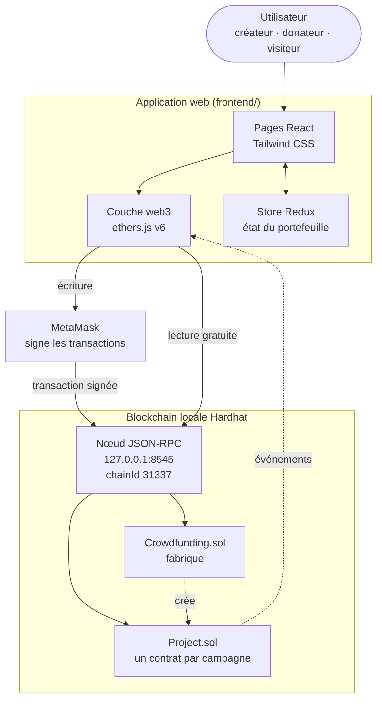
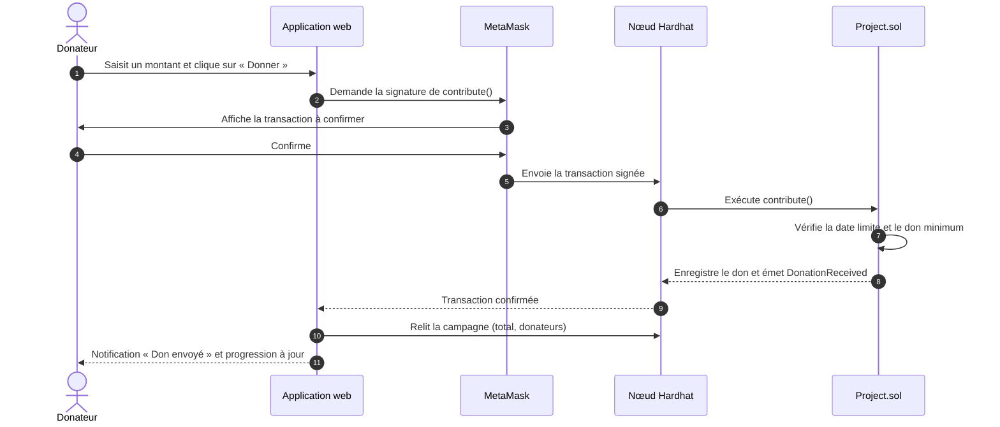
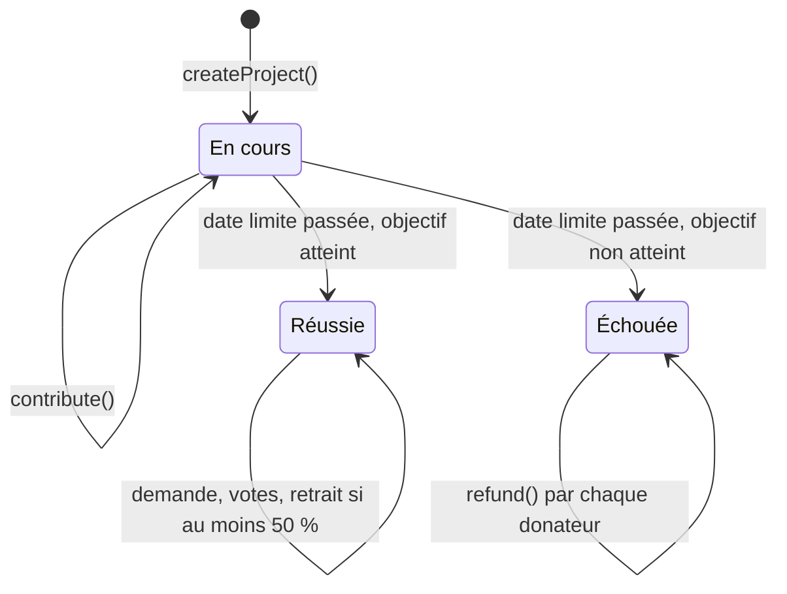

# Plateforme de financement participatif sur blockchain

**🌐 Langue / Language :** Français · [English](README.en.md)

Application décentralisée (DApp) de financement participatif sur Ethereum : les fonds sont gardés par un smart contract, débloqués par le vote des donateurs et rendus aux donateurs si l'objectif n'est pas atteint.

## Sommaire

1. [Introduction](#1-introduction)
2. [Architecture générale](#2-architecture-générale)
3. [Outils utilisés](#3-outils-utilisés)
4. [Arborescence du projet](#4-arborescence-du-projet)
5. [Fonctionnalités](#5-fonctionnalités)
6. [Installation](#6-installation)
7. [Membres de l'équipe](#7-membres-de-léquipe)

---

## 1. Introduction

Sur une plateforme de financement participatif classique, l'argent des donateurs est confié à un intermédiaire. C'est lui qui décide quand le créateur reçoit les fonds et si les donateurs sont remboursés en cas d'échec : il faut lui faire confiance.

Ce projet remplace cet intermédiaire par des **smart contracts** Ethereum. Un créateur lance une campagne avec un **objectif**, un **don minimum** et une **durée**. Les donateurs envoient de l'ETH, qui reste bloqué dans le contrat de la campagne jusqu'à la date limite. Ensuite :

- **objectif atteint** : le créateur peut retirer les fonds, mais uniquement pour des demandes approuvées par au moins **50 % des donateurs** ;
- **objectif non atteint** : chaque donateur récupère **exactement sa mise**.

Les règles sont écrites dans le code et ne peuvent plus être modifiées après le déploiement, ni par le créateur ni par l'équipe. L'application tourne sur une blockchain Ethereum locale (Hardhat) et s'utilise depuis le navigateur avec MetaMask.

| | Financement participatif classique | Ce projet |
| --- | --- | --- |
| Qui garde l'argent ? | Un intermédiaire | Le contrat de la campagne |
| Qui fixe les règles ? | La plateforme, qui peut les changer | Le code, figé au déploiement |
| Qui débloque les fonds ? | La plateforme | Au moins 50 % des donateurs, par un vote |
| Remboursement en cas d'échec | Selon la politique de la plateforme | Garanti : chaque donateur récupère sa mise via le contrat |

---

## 2. Architecture générale

Le projet repose sur deux smart contracts déployés sur une blockchain locale, une application web React et MetaMask, qui signe les transactions de l'utilisateur.



| Élément | Rôle |
| --- | --- |
| `Crowdfunding.sol` | La **fabrique** : crée un contrat `Project` pour chaque nouvelle campagne et garde la liste de toutes les campagnes. |
| `Project.sol` | Une **campagne** : garde ses propres fonds, enregistre le créateur et les donateurs, gère les demandes de retrait, les votes et les remboursements. |
| Nœud Hardhat | Blockchain Ethereum locale, avec 20 comptes de test crédités de 10 000 ETH chacun. |
| MetaMask | Portefeuille du navigateur : signe chaque transaction (créer, donner, voter, retirer, se faire rembourser). |
| Application web | Lit les campagnes directement sur le nœud, même sans MetaMask, et passe par MetaMask pour toute écriture. |

Principes de conception :

- **Un contrat par campagne** : les fonds de chaque campagne sont séparés de ceux des autres.
- **Lecture gratuite, écriture signée** : consulter une campagne ne coûte rien et ne demande pas de portefeuille ; chaque action est une transaction signée dans MetaMask.
- **État calculé, pas stocké** : `getStatus()` déduit l'état de la campagne de l'heure et du total collecté. Aucune transaction n'est nécessaire pour clôturer une campagne.
- **Mise à jour en direct** : chaque action émet un événement (`DonationReceived`, `WithdrawVote`…) que l'application écoute pour se rafraîchir toute seule.
- **Lien entre contrats et interface** : après le déploiement, `npm run sync` copie les ABI et l'adresse de la fabrique dans `frontend/src/`.

### Parcours d'un don



---

## 3. Outils utilisés

| Domaine | Outil | Version | Utilisation |
| --- | --- | --- | --- |
| **Smart contracts** | Solidity | 0.8.24 | Langage des contrats |
| | Hardhat + Hardhat Toolbox | 2.29 / 5.0 | Compilation, blockchain locale, exécution des tests et des scripts |
| | Hardhat Ignition | 0.15 | Déploiement de la fabrique |
| **Tests** | Mocha + Chai | 11 / 4 | Tests des contrats |
| | solidity-coverage | 0.8 | Couverture de code des contrats |
| | Vitest + Testing Library + jsdom | 2.1 / 16 / 25 | Tests de l'application web |
| **Frontend** | React | 18.3 | Interface utilisateur |
| | Vite | 5.4 | Serveur de développement et build |
| | Tailwind CSS | 3.4 | Mise en forme |
| | Redux Toolkit + React Redux | 2.14 / 9.3 | État global (portefeuille connecté) |
| | React Router | 6.30 | Navigation entre les pages |
| | ethers.js | 6.17 | Lecture des contrats et envoi des transactions |
| **Portefeuille** | MetaMask | extension | Signature des transactions |
| **Qualité** | GitHub Actions | | Intégration continue : compilation, tests, couverture, build |
| | Hook Git `pre-commit` | | Compilation, tests et contrôles avant chaque commit |
| **Environnement** | Node.js + npm | 18 ou plus | Exécution de tous les outils |

---

## 4. Arborescence du projet

```text
plateforme-crowdfunding-blockchain/
├── contracts/
│   ├── Crowdfunding.sol               # fabrique : crée et liste les campagnes
│   ├── Project.sol                    # une campagne : fonds, votes, remboursements
│   └── test/
│       └── ReentrancyAttacker.sol     # contrat malveillant utilisé par les tests
├── test/                              # tests des contrats (Mocha + Chai)
│   ├── Crowdfunding.js                # fabrique et module de déploiement
│   ├── Project.js                     # chaque fonction d'une campagne, sécurité
│   ├── ProjectBoundaries.js           # valeurs limites et invariants
│   └── Lifecycle.js                   # parcours complets de bout en bout
├── ignition/modules/
│   └── Crowdfunding.js                # déploiement avec Hardhat Ignition
├── scripts/
│   ├── syncAbi.js                     # copie les ABI et l'adresse vers frontend/src
│   ├── seedDemo.js                    # crée 3 campagnes de démonstration
│   ├── simulate.js                    # rejoue les scénarios A et B dans le terminal
│   ├── fastForward.js                 # avance l'horloge de la blockchain locale
│   └── precommit.sh                   # vérifications lancées avant chaque commit
├── frontend/                          # application web (React + Vite)
│   ├── index.html
│   ├── vite.config.js                 # configuration de Vite et Vitest
│   ├── tailwind.config.js
│   ├── .env.example                   # VITE_RPC_URL, VITE_FACTORY_ADDRESS
│   └── src/
│       ├── main.jsx                   # point d'entrée : Redux, routeur, erreurs
│       ├── App.jsx                    # routes des pages
│       ├── config.js                  # réseau, URL RPC, adresse de la fabrique
│       ├── deployed.json              # adresse de la fabrique (npm run sync)
│       ├── abi/                       # ABI des contrats (npm run sync)
│       ├── web3/                      # ethers.js : lectures, transactions, erreurs
│       ├── store/                     # store Redux (portefeuille)
│       ├── hooks/                     # useWallet, useTransaction, useChainEvents…
│       ├── components/                # en-tête, cartes, progression, notifications
│       └── pages/                     # Accueil, Créer, Détail, Mes contributions
├── docs/
│   ├── commun/
│   │   ├── CahierDesCharges.pdf       # cahier des charges
│   │   ├── GUIDE_DEPLOIEMENT.md       # déploiement local détaillé, dépannage
│   │   ├── GUIDE_METAMASK_HARDHAT.md  # configuration de MetaMask
│   │   ├── RECETTE.md                 # scénarios de test manuels A à F
│   │   ├── rapport/                   # rapport du projet
│   │   └── presentation/              # présentation et scénario de démo
│   └── etudiant1-smart-contracts/
│       └── phase1.md                  # smart contracts expliqués en détail
├── .github/workflows/ci.yml           # intégration continue (GitHub Actions)
├── .githooks/pre-commit               # lance scripts/precommit.sh
├── hardhat.config.js                  # Solidity 0.8.24, réseau localhost (31337)
├── .solcover.js                       # configuration de la couverture
├── package.json                       # scripts npm du projet
├── README.md
└── README.en.md
```

Les tests du frontend (`*.test.js`, `*.test.jsx`) sont placés à côté des fichiers qu'ils testent.

---

## 5. Fonctionnalités

### Fonctionnalités principales

| Réf. | Fonctionnalité | Acteur | Fonction du contrat |
| --- | --- | --- | --- |
| F1 | Créer une campagne : titre, description, objectif, don minimum, durée | Créateur | `Crowdfunding.createProject()` |
| F2 | Donner de l'ETH avant la date limite, au moins le don minimum | Donateur | `Project.contribute()` |
| F3 | Consulter une campagne : objectif, total collecté, donateurs, temps restant, état | Tout le monde | `getStatus()`, `timeLeft()`, `getDonors()` |
| F4 | Demander un retrait (montant, motif, destinataire) après une campagne réussie | Créateur | `createWithdrawRequest()` |
| F5 | Voter pour une demande, puis retirer les fonds si au moins 50 % des donateurs l'ont approuvée | Donateurs, puis créateur | `voteWithdrawRequest()`, `withdrawRequestedAmount()` |
| F6 | Récupérer sa mise si l'objectif n'est pas atteint à la date limite | Donateur | `refund()` |
| F7 | Utiliser toutes ces fonctions depuis une interface web connectée à MetaMask | Tout le monde | `frontend/` |

### Cycle de vie d'une campagne



L'état n'est jamais stocké : `getStatus()` le recalcule à chaque lecture à partir de l'heure et du total collecté.

### Règles de gestion

| Règle | Description |
| --- | --- |
| RG1 | L'objectif, le don minimum et la durée doivent être supérieurs à 0 : la date limite est donc toujours dans le futur. |
| RG2 | Aucun don n'est accepté après la date limite ni en dessous du don minimum. |
| RG3 | Les fonds restent bloqués dans le contrat jusqu'à la date limite. |
| RG4 | Un retrait n'est exécuté que si au moins 50 % des donateurs l'ont approuvé (une voix par donateur). |
| RG5 | Chaque donateur récupère exactement sa contribution, une seule fois. |

### Sécurité

- **Protection contre la réentrance** : la contribution est remise à zéro, ou la demande marquée comme exécutée, **avant** l'envoi des ETH.
- **Accès contrôlé** : seul le créateur peut demander et exécuter un retrait ; seuls les donateurs peuvent voter.
- **Pas de double action** : un seul vote par donateur et par demande, un seul remboursement par donateur, une seule exécution par demande.
- **Virement échoué, transaction annulée** : si l'envoi d'ETH échoue, rien n'est modifié.
- **Règles figées** : le créateur, l'objectif, le don minimum et la date limite sont `immutable`.

### Interface web

- **Accueil** : toutes les campagnes avec leur barre de progression, leur temps restant et leur état ; filtres (en cours, réussies, échouées) et tri (récentes, montant collecté, temps restant).
- **Créer une campagne** : formulaire qui vérifie les champs avant l'envoi.
- **Détail d'une campagne** : don avec montants proposés, liste des donateurs, demandes de retrait avec barre de votes. Les actions proposées (donner, demander un retrait, voter, retirer, se faire rembourser) dépendent de l'état de la campagne et du rôle du compte connecté.
- **Mes contributions** : les campagnes soutenues par le compte connecté et le total donné.
- **Sans MetaMask** : les campagnes restent consultables en lecture seule.
- **Bon réseau** : détection d'un mauvais réseau et bouton pour passer sur Hardhat Local (31337).
- **Retours clairs** : aperçu de la transaction avant signature, notifications de succès ou d'échec, erreurs du contrat traduites en français.
- **Responsive** : utilisable sur téléphone comme sur ordinateur.

---

## 6. Installation

### Prérequis

- [Git](https://git-scm.com/)
- [Node.js](https://nodejs.org/) 18 ou plus (version LTS conseillée), avec npm
- L'extension [MetaMask](https://metamask.io/) dans le navigateur

### Étape 1 — Cloner le dépôt

```bash
git clone https://github.com/Chaksterr/plateforme-crowdfunding-blockchain.git
cd plateforme-crowdfunding-blockchain
```

### Étape 2 — Installer les dépendances et vérifier

```bash
npm install     # Hardhat et les outils des contrats
npm test        # doit afficher : 82 passing
```

### Étape 3 — Lancer la blockchain locale (terminal 1)

```bash
npm run node
```

Laisser ce terminal ouvert. Il affiche 20 comptes de test, chacun crédité de 10 000 ETH, avec leur clé privée.

### Étape 4 — Déployer les contrats (terminal 2)

```bash
npm run deploy  # déploie la fabrique : 0x5FbDB2315678afecb367f032d93F642f64180aa3
npm run sync    # copie les ABI et l'adresse dans frontend/src
npm run seed    # facultatif : 3 campagnes de démo (en cours, réussie, échouée)
```

### Étape 5 — Lancer l'application web (terminal 2)

```bash
cd frontend
npm install
npm run dev     # http://localhost:5173
```

### Étape 6 — Configurer MetaMask

1. Ajouter le réseau : **Paramètres → Réseaux → Ajouter un réseau manuellement**
   - Nom : `Hardhat Local`
   - URL RPC : `http://127.0.0.1:8545`
   - ID de chaîne : `31337`
   - Symbole : `ETH`
2. Importer quelques comptes de test avec les clés privées affichées dans le terminal 1. `npm run seed` utilise le compte #0 comme créateur et les comptes #1 à #3 comme donateurs.
3. Ouvrir <http://localhost:5173> et cliquer sur **Connecter MetaMask**.

> ⚠️ Ces clés de test sont publiques. Ne les utilisez jamais sur un vrai réseau et n'envoyez jamais de vrais fonds à ces adresses.

> 🔁 Après chaque redémarrage de `npm run node` : relancer `npm run deploy:reset` (puis `npm run seed` si besoin), et dans MetaMask choisir **Paramètres → Avancé → Effacer les données d'activité**, sinon les transactions sont bloquées (« nonce too high »).

### Commandes utiles

| Commande | Effet |
| --- | --- |
| `npm run coverage` | Rapport de couverture des contrats |
| `npm run simulate` | Rejoue les scénarios A (réussite) et B (échec) dans le terminal |
| `SECONDS=120 npm run ff` | Avance l'horloge de la blockchain de 120 secondes, par exemple pour terminer une campagne |
| `npm run deploy:reset` | Redéploie la fabrique après un redémarrage du nœud |
| `npm test` (dans `frontend/`) | Tests de l'application web : 191 tests |
| `npm run build` (dans `frontend/`) | Build de production |

Guide détaillé (multi-PC, dépannage) : [docs/commun/GUIDE_DEPLOIEMENT.md](docs/commun/GUIDE_DEPLOIEMENT.md).

---

## 7. Membres de l'équipe

- Yessine Abdelmaksoud
- Mohamed Ali Abid
- Ahmad Chakcha
- Mohamed Ali Djemal
