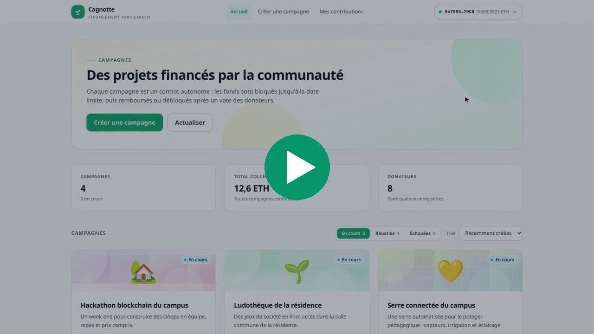
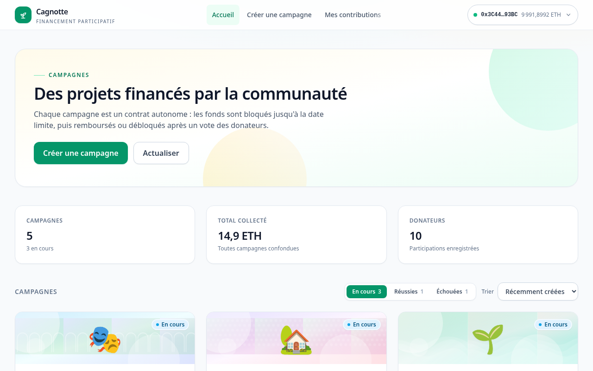
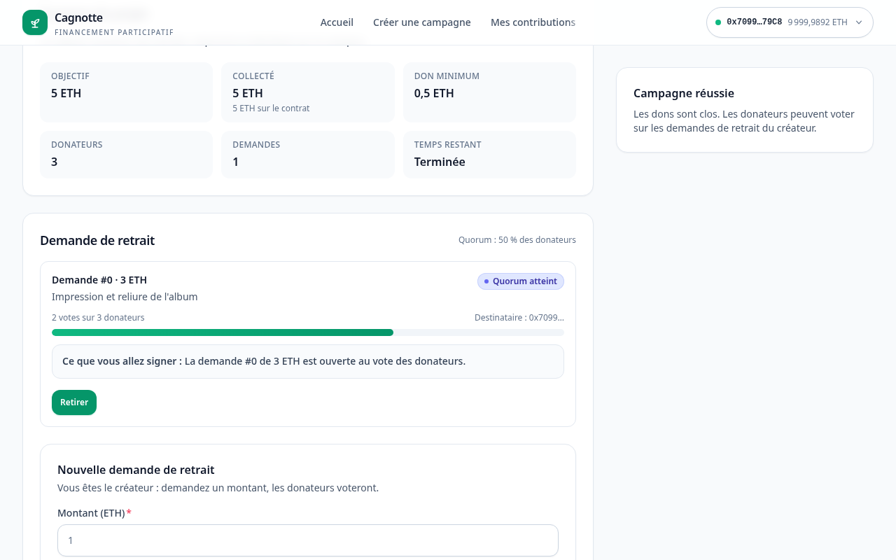
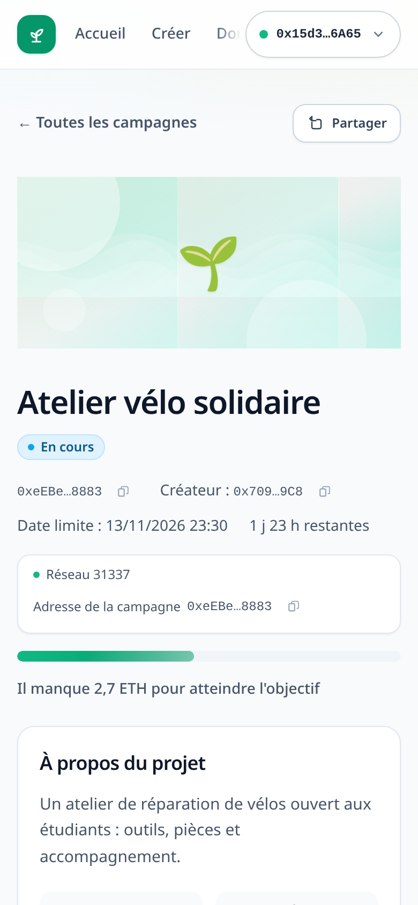
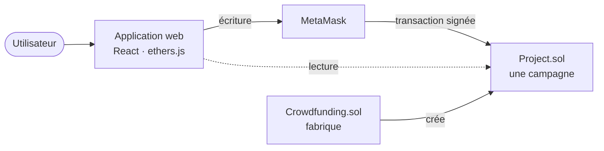
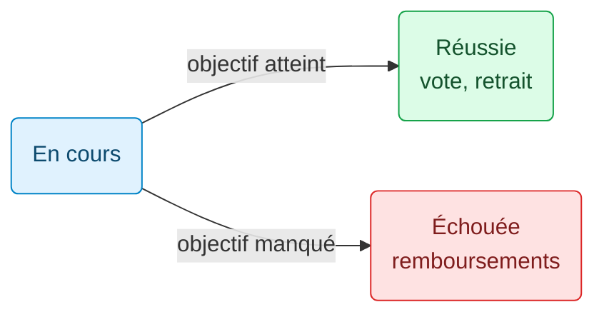

<div align="center">


# Cagnotte

**Le code garde, les donateurs décident.**

*Une plateforme de financement participatif décentralisée sur Ethereum : les fonds sont gardés par un smart contract, débloqués par le vote des donateurs et rendus à chacun si l'objectif n'est pas atteint.*

<br>


<br>


<br><br>

**[🎬 Démo vidéo](#2-démonstration)** · **[⚙️ Installation](#6-installation)** · **[📄 Rapport](docs/commun/rapport/rapport.tex)**

**🌐 Langue / Language :** Français · [English](README.en.md)

</div>

---

## Sommaire

1. [Introduction](#1-introduction)
2. [Démonstration](#2-démonstration)
3. [Architecture](#3-architecture)
4. [Outils utilisés](#4-outils-utilisés)
5. [Fonctionnalités](#5-fonctionnalités)
6. [Installation](#6-installation)
7. [Membres de l'équipe](#7-membres-de-léquipe)

---

## 1. Introduction

Sur une plateforme de financement participatif classique, l'argent des donateurs est confié à un intermédiaire. C'est lui qui décide quand le créateur reçoit les fonds et si les donateurs sont remboursés en cas d'échec : il faut lui faire confiance.

**Cagnotte** remplace cet intermédiaire par des **smart contracts** Ethereum. Un créateur lance une campagne avec un **objectif**, un **don minimum** et une **durée**. Les dons restent bloqués dans le contrat de la campagne jusqu'à la date limite. Ensuite :

- ✅ **objectif atteint** : le créateur retire les fonds, uniquement pour des demandes approuvées par au moins **50 % des donateurs** ;
- ↩️ **objectif non atteint** : chaque donateur récupère **exactement sa mise**.

| | Financement participatif classique | Cagnotte |
| --- | --- | --- |
| Qui garde l'argent ? | Un intermédiaire | Le contrat de la campagne |
| Qui fixe les règles ? | La plateforme, qui peut les changer | Le code, figé au déploiement |
| Qui débloque les fonds ? | La plateforme | Au moins 50 % des donateurs, par un vote |
| Remboursement en cas d'échec | Selon la politique de la plateforme | Garanti par le contrat |

---

## 2. Démonstration

<div align="center">

<a href="docs/commun/demo/demo-cagnotte.mp4">
  
</a>

**🎬 [Vidéo de démonstration](docs/commun/demo/demo-cagnotte.mp4)**<br>
<sub>Accueil · campagne réussie (dons, vote, retrait) · campagne échouée (remboursements) · consultation sans MetaMask</sub>

<br>

| Accueil | Vote et retrait | Sur téléphone |
| :---: | :---: | :---: |
|  |  |  |

<sub>Toutes les captures : <a href="docs/commun/captures/">docs/commun/captures/</a></sub>

</div>

---

## 3. Architecture



| Élément | Rôle |
| --- | --- |
| `Crowdfunding.sol` | La **fabrique** : crée un contrat `Project` pour chaque campagne et garde la liste. |
| `Project.sol` | Une **campagne** : garde ses fonds, ses donateurs, les demandes de retrait, les votes et les remboursements. |
| Application web | Lit les campagnes directement sur la blockchain, **même sans MetaMask**, et passe par MetaMask pour toute écriture. |
| Nœud Hardhat | Blockchain Ethereum locale (`127.0.0.1:8545`, chaîne `31338`), 20 comptes de test à 10 000 ETH. |

**Principes de conception**

- **Un contrat par campagne** : les fonds de chaque campagne sont isolés.
- **État calculé, pas stocké** : `getStatus()` déduit l'état de l'heure et du total collecté ; aucune transaction de clôture.
- **Mise à jour en direct** : l'interface écoute les événements du contrat (`DonationReceived`, `WithdrawVote`…).

---

## 4. Outils utilisés

| Domaine | Outils |
| --- | --- |
| **Smart contracts** | Solidity 0.8.24, Hardhat 2.29, Hardhat Ignition, ethers.js 6 |
| **Interface web** | React 18, Vite 5, Tailwind CSS 3, Redux Toolkit, React Router |
| **Portefeuille** | MetaMask |
| **Tests** | Mocha + Chai, Vitest + Testing Library, Playwright |
| **Qualité** | GitHub Actions, hook Git `pre-commit` |
| **Environnement** | Node.js 22 ou plus, npm |

**Résultats des tests :** 82 tests des contrats (couverture 100 %) · 198 tests de l'interface · 12 tests de bout en bout.

---

## 5. Fonctionnalités

| Réf. | Fonctionnalité | Acteur | Fonction du contrat |
| --- | --- | --- | --- |
| F1 | Créer une campagne : titre, description, objectif, don minimum, durée | Créateur | `Crowdfunding.createProject()` |
| F2 | Donner de l'ETH avant la date limite, au moins le don minimum | Donateur | `Project.contribute()` |
| F3 | Consulter une campagne : objectif, total, donateurs, temps restant, état | Tout le monde | `getStatus()`, `timeLeft()`, `getDonors()` |
| F4 | Demander un retrait (montant, motif, destinataire) | Créateur | `createWithdrawRequest()` |
| F5 | Voter, puis retirer si au moins 50 % des donateurs approuvent | Donateurs, créateur | `voteWithdrawRequest()`, `withdrawRequestedAmount()` |
| F6 | Récupérer sa mise si l'objectif n'est pas atteint | Donateur | `refund()` |
| F7 | Tout faire depuis une interface web connectée à MetaMask | Tout le monde | `frontend/` |

### Cycle de vie d'une campagne



### Règles et sécurité

- **RG1 à RG5** : paramètres strictement positifs, aucun don après la date limite ni sous le minimum, fonds bloqués jusqu'à la date limite, retrait seulement avec au moins 50 % d'approbation, remboursement exact et unique.
- **Réentrance** : la contribution est remise à zéro, ou la demande marquée comme exécutée, **avant** l'envoi des ETH.
- **Accès contrôlé** : seul le créateur retire ; seuls les donateurs votent ; un seul vote par donateur et par demande.
- **Règles figées** : créateur, objectif, don minimum et date limite sont `immutable`.

<details>
<summary><b>Arborescence du projet</b></summary>

```text
Crowdfunding-blockchain/
├── contracts/                 # Crowdfunding.sol (fabrique), Project.sol (campagne)
├── test/                      # tests des contrats (Mocha + Chai)
├── e2e/                       # tests de bout en bout (Playwright)
├── ignition/modules/          # déploiement avec Hardhat Ignition
├── scripts/                   # sync des ABI, campagnes de démo, avance de l'horloge
├── frontend/                  # application web (React + Vite)
│   └── src/                   # pages, composants, web3, store Redux, hooks
├── docs/commun/
│   ├── captures/              # captures d'écran
│   ├── demo/                  # vidéo de démonstration
│   └── rapport/               # rapport du projet (LaTeX)
├── .github/workflows/ci.yml   # intégration continue
└── hardhat.config.js          # Solidity 0.8.24, réseau local (31338)
```

</details>

---

## 6. Installation

**Prérequis :** [Git](https://git-scm.com/), [Node.js](https://nodejs.org/) 22 ou plus avec npm, et l'extension [MetaMask](https://metamask.io/).

```bash
# 1. Cloner et vérifier
git clone https://github.com/Chaksterr/Crowdfunding-blockchain.git
cd Crowdfunding-blockchain
npm install
npm test              # doit afficher : 82 passing

# 2. Terminal 1 : lancer la blockchain locale (laisser ouvert)
npm run node

# 3. Terminal 2 : déployer et lancer l'application
npm run deploy        # fabrique : 0x5FbDB2315678afecb367f032d93F642f64180aa3
npm run sync          # copie les ABI et l'adresse dans frontend/src
npm run seed          # facultatif : 3 campagnes de démo
cd frontend && npm install && npm run dev   # http://localhost:5173
```

**Configurer MetaMask**

1. Ajouter le réseau **Hardhat Local** : URL RPC `http://127.0.0.1:8545`, ID de chaîne `31338`, symbole `ETH`.
2. Importer quelques comptes de test avec les clés privées affichées par `npm run node`.
3. Ouvrir <http://localhost:5173> et cliquer sur **Connecter MetaMask**.

> ⚠️ Les clés de test sont publiques : ne les utilisez jamais sur un vrai réseau.
>
> 🔁 Après un redémarrage de `npm run node` : relancer `npm run deploy:reset`, puis dans MetaMask **Paramètres → Avancé → Effacer les données d'activité**.

<details>
<summary><b>Commandes utiles</b></summary>

| Commande | Effet |
| --- | --- |
| `npm run coverage` | Rapport de couverture des contrats |
| `npm run simulate` | Rejoue les scénarios A (réussite) et B (échec) dans le terminal |
| `SECONDS=120 npm run ff` | Avance l'horloge de la blockchain de 120 secondes |
| `npm run deploy:reset` | Redéploie la fabrique après un redémarrage du nœud |
| `npm test` (dans `frontend/`) | Tests de l'application web |
| `npm run e2e` | Tests de bout en bout (la première fois : `npx playwright install chromium`) |
| `npm run e2e:captures` | Régénère les captures d'écran |

</details>

---

## 7. Membres de l'équipe

| Membre | Rôle |
| --- | --- |
| Mohamed Ali Djemal | Interface web et Web3 |
| Mohamed Ali Abid | Recette et démonstration |
| Yessine Abdelmaksoud | Tests et déploiement |
| Ahmad Chakcha | Smart contracts et sécurité |

<div align="center"><sub>Projet réalisé dans le cadre de la matière Blockchain · Année universitaire 2026 – 2027</sub></div>
