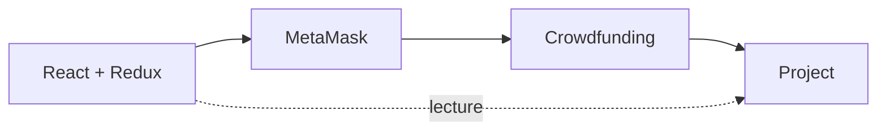
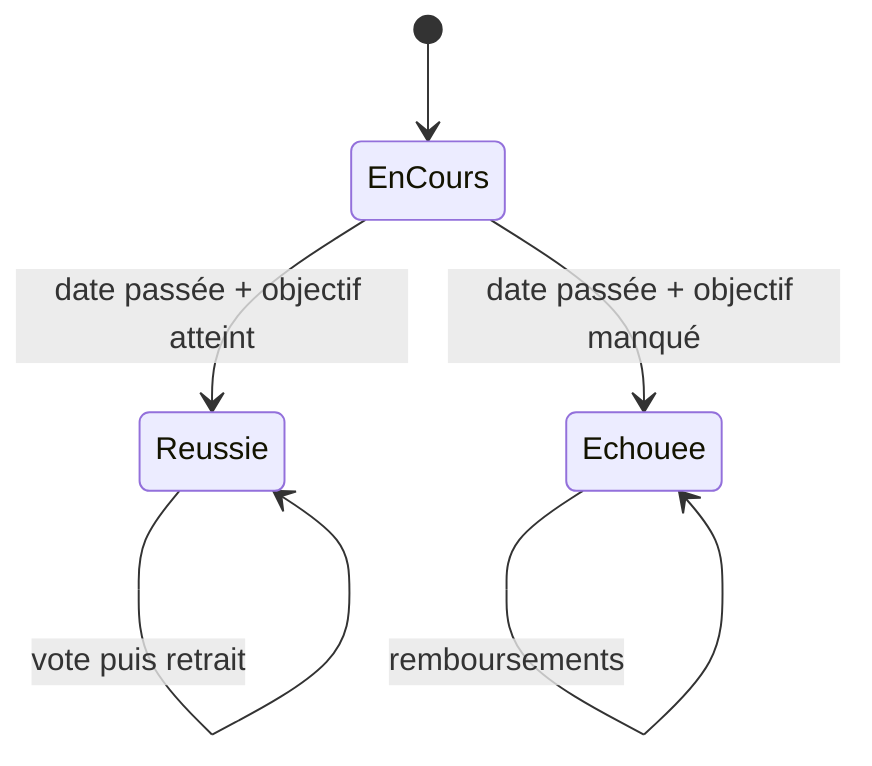

# Support de présentation (~15 minutes)

> Plan de slides prêt à recopier dans PowerPoint / Google Slides. Chaque slide indique le message clé et le visuel conseillé.

## Slide 1 — Titre

**Cagnotte — financement participatif sur blockchain**
DApp de collecte conditionnelle sur Ethereum
Noms des 4 étudiants · Promotion · Date

Visuel : capture de la page d'accueil.

## Slide 2 — Le problème

- Une plateforme classique conserve l'argent et décide du déblocage.
- Les contributeurs doivent faire confiance à un intermédiaire.
- En cas d'échec, le remboursement dépend de ses règles internes.

Message clé : **et si les règles étaient dans le code ?**

## Slide 3 — Notre réponse

Un smart contract par campagne :

1. objectif, don minimum et date limite fixés à la création ;
2. fonds conservés par le contrat, jamais par le créateur ;
3. retrait uniquement après vote des donateurs ;
4. remboursement automatique si l'objectif échoue.

Visuel : schéma utilisateur → MetaMask → contrat.

## Slide 4 — Acteurs et fonctionnalités

| Acteur | Actions |
| --- | --- |
| Visiteur | consulter |
| Donateur | donner, voter, rembourser |
| Créateur | créer, demander un retrait, retirer |

F1 à F6 : création, don, consultation, demande, vote/retrait, remboursement. F7 : interface web.

## Slide 5 — Architecture



- `Crowdfunding` : fabrique, liste des campagnes.
- `Project` : fonds, donateurs, demandes et votes d'une campagne.
- Frontend : ethers v6, deux providers (lecture / signature).

## Slide 6 — Cycle de vie



Point clé : l'état est **calculé**, pas stocké. Aucune transaction de clôture.

## Slide 7 — Le vote

- Une voix par donateur, quel que soit le montant.
- Seuil : `approbations × 2 ≥ nombre de donateurs`.
- Le créateur exécute le retrait ; le contrat vérifie le quorum.
- Une demande ne peut être exécutée qu'une fois.

Visuel : 3 donateurs, 2 votes, retrait accepté.

## Slide 8 — Sécurité

| Attaque | Défense |
| --- | --- |
| Réentrance | état mis à jour avant l'appel externe |
| Double vote | mapping `hasVoted` |
| Double remboursement | contribution remise à 0 |
| Retrait non autorisé | `onlyCreator` |
| Virement refusé | `require(ok)`, atomicité |

Insister : pas de `transfer`, pas de `nonReentrant` nécessaire grâce à l'ordre checks-effects-interactions.

## Slide 9 — Tests

- **82 tests de contrat** : 42 `Project`, 12 `Crowdfunding`, 24 valeurs limites et invariants, 4 cycles de vie complets.
- **100 %** de couverture (lignes, branches, fonctions, statements).
- **198 tests frontend** (Vitest) et **12 tests de bout en bout** (Playwright) qui rejouent les scénarios A à F dans un vrai navigateur.
- Tests de sécurité : contrat attaquant, récepteur qui refuse, double action.
- Commandes : `npm test` et `npm run e2e` (démonstration possible).

Visuel : capture du terminal « 82 passing » et du résultat Playwright « 12 passed ».

## Slide 10 — Déploiement

```bash
npm run node      # blockchain locale
npm run deploy    # fabrique Ignition
npm run sync      # ABI + adresse vers le frontend
npm run seed      # 3 campagnes de démo
cd frontend && npm run dev
```

- Adresse déterministe : `0x5FbDB2315678afecb367f032d93F642f64180aa3`.
- CI GitHub Actions : tests, couverture, dry-run Ignition, build frontend.
- Hook pre-commit identique.

## Slide 11 — Interface : accueil

Visuel : grille de cartes.

- Badge d'état, progression, objectif, date, donateurs.
- Lecture sans MetaMask.
- Trois campagnes de démo : en cours, réussie, échouée.

## Slide 12 — Interface : détail et don

Visuel : page campagne.

- Métriques et solde du contrat.
- Formulaire de don avec minimum.
- Liste des donateurs et contribution individuelle.
- Messages d'erreur traduits.

## Slide 13 — Interface : vote et remboursement

Visuel : demandes de retrait.

- Formulaire réservé au créateur.
- Barre de quorum, bouton Voter, bouton Retirer.
- Bouton Rembourser si la campagne a échoué.
- Rafraîchissement après transaction.

## Slide 14 — Démonstration

- Scénario A : 3 × 2 ETH, demande 4 ETH, 2 votes sur 3, retrait.
- Scénario B : objectif manqué, remboursements, contrat à 0.
- Scénario F : lecture sans MetaMask.

Basculer sur l'application (voir `DEMO_SCENARIO.md`).

## Slide 15 — Limites

- Quorum sur le nombre de donateurs, pas sur les montants.
- Créateur seul donateur → il peut approuver sa propre demande.
- Demandes non annulables, fonds bloqués sans demande.
- Pas d'audit, pas de mise à jour, réseau local uniquement.
- Sybil possible.

## Slide 16 — Perspectives et conclusion

- Sepolia, vote pondéré, IPFS, annulation, plafond de donateurs.
- Ce que le projet démontre : règles vérifiables, fonds isolés, remboursement automatique.
- Ce que nous avons appris : sécurité, tests, intégration wallet, travail d'équipe.

**Merci — questions.**

---

## Notes de présentation

- Durée cible : 15 min, dont 6 min de démo.
- Ne pas lire les slides : une idée par slide.
- Garder un terminal propre et une vidéo de secours.
- Répartition : étudiant 4 (intro/architecture/démo B), étudiant 1 (contrats/sécurité), étudiant 2 (tests/déploiement), étudiant 3 (interface/démo A).
