# Rapport de projet — Plateforme de financement participatif sur blockchain

**Équipe :** 4 étudiants
**Stack :** Solidity 0.8.24 · Hardhat · Hardhat Ignition · ethers.js v6 · React · Redux Toolkit · Tailwind CSS · MetaMask
**Réseau de démonstration :** Hardhat local, chainId `31337`

---

## 1. Introduction et contexte

Le financement participatif classique repose sur un intermédiaire : une plateforme collecte les fonds, prélève une commission et décide des conditions de déblocage. Les contributeurs doivent lui faire confiance pour conserver les fonds, vérifier l'usage promis et rembourser en cas d'échec.

Ce projet remplace cet intermédiaire par un **smart contract** déployé sur Ethereum. Une campagne est un contrat autonome qui :

- conserve les fonds des donateurs ;
- applique des règles fixées à la création (objectif, don minimum, date limite) ;
- n'autorise le créateur à retirer les fonds qu'après un vote favorable des donateurs ;
- rembourse automatiquement chaque donateur si l'objectif n'est pas atteint.

L'objectif pédagogique est double : concevoir un contrat correct et sûr, puis construire une interface web complète qui rend le cycle de vie d'une campagne visible et manipulable avec MetaMask.

Le projet suit trois phases : contrats et sécurité (phase 1), interface web et données de démo (phase 2), recette, rapport et démonstration (phase 3).

---

## 2. Spécifications

### 2.1 Acteurs

| Acteur | Rôle |
| --- | --- |
| Visiteur | consulte les campagnes sans portefeuille |
| Donateur | connecte MetaMask, donne, vote, retire son remboursement |
| Créateur | lance une campagne, demande un retrait, exécute le retrait approuvé |

Un même compte peut être créateur d'une campagne et donateur d'une autre. Le créateur peut aussi donner à sa propre campagne.

### 2.2 Fonctionnalités

| Réf. | Fonctionnalité | Fonction |
| --- | --- | --- |
| F1 | Créer une campagne (titre, description, objectif, don minimum, durée) | `Crowdfunding.createProject()` |
| F2 | Donner avant la date limite, montant ≥ minimum | `Project.contribute()` |
| F3 | Consulter objectif, date limite, total, donateurs, temps restant, état | `getStatus()`, `timeLeft()`, `getDonors()` |
| F4 | Demander un retrait (montant, motif, destinataire) si la campagne réussit | `createWithdrawRequest()` |
| F5 | Voter, puis retirer si au moins 50 % des donateurs approuvent | `voteWithdrawRequest()`, `withdrawRequestedAmount()` |
| F6 | Se faire rembourser si le total est inférieur à l'objectif après la date limite | `refund()` |
| F7 | Interface web avec MetaMask | `frontend/` |

### 2.3 Règles de gestion

| Réf. | Règle | Mise en œuvre |
| --- | --- | --- |
| RG1 | Paramètres positifs, date limite dans le futur | `require` du constructeur et durée > 0 |
| RG2 | Pas de don après la date limite ni sous le minimum | `require` de `contribute()` |
| RG3 | Fonds bloqués jusqu'à la date limite | aucune sortie possible pendant l'état « En cours » |
| RG4 | Retrait si au moins 50 % des donateurs approuvent | `approvals * 2 >= donors.length` |
| RG5 | Chaque donateur récupère sa contribution, une seule fois | contribution remise à 0 avant l'envoi |

### 2.4 Écarts assumés par rapport au cahier des charges

Trois choix ont été faits pour simplifier le contrat sans réduire les garanties :

1. **État calculé, non stocké.** `getStatus()` compare l'horloge et le total collecté. Aucune transaction n'est nécessaire pour clôturer une campagne, et l'état ne peut pas être incohérent.
2. **Durée au lieu d'une date.** L'interface saisit des minutes ; le contrat calcule `deadline = block.timestamp + duration`. Cela supprime les problèmes de fuseau horaire et de date passée.
3. **Fabrique de campagnes.** Un contrat `Crowdfunding` déploie un contrat `Project` par campagne. Chaque campagne isole ses fonds et ses donateurs, et la liste globale reste simple à parcourir.

---

## 3. Architecture

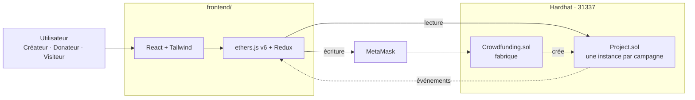

- **Crowdfunding** est déployé une fois. Il crée les campagnes et expose la liste des adresses.
- **Project** est déployé par la fabrique. Il contient les fonds, les contributions et les demandes de retrait d'une seule campagne.
- Le frontend utilise deux fournisseurs : `BrowserProvider` pour signer avec MetaMask, `JsonRpcProvider` pour lire sans portefeuille.
- Les événements (`DonationReceived`, `WithdrawVote`, `FundsWithdrawn`, `Refunded`) permettent de rafraîchir l'interface sans interrogation constante.

Cette séparation evite un contrat monolithique : une campagne ne peut pas modifier les fonds d'une autre, et la fabrique n'a aucun droit sur les fonds.

---

## 4. Smart contracts et sécurité

### 4.1 `Crowdfunding.sol`

| Élément | Rôle |
| --- | --- |
| `createProject(title, description, goal, minContribution, duration)` | déploie un `Project`, l'ajoute à la liste, émet `ProjectCreated` |
| `getProjects()` / `getProjectsCount()` | lecture de la liste |
| `projects(uint256)` | lecture d'une adresse par index |

Le créateur enregistré est `msg.sender`. La fabrique ne conserve aucun ETH et n'a pas de fonction de retrait : elle ne peut pas toucher aux fonds des campagnes.

### 4.2 `Project.sol`

**Données immuables :** créateur, objectif, don minimum, date limite. Le titre et la description sont en lecture seule après création.

**Données mutables :** total collecté, contributions par adresse, liste des donateurs, demandes de retrait, votes.

**Cycle de vie :**

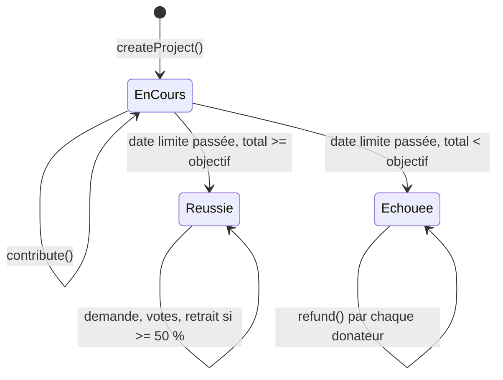

L'état est calculé :

```solidity
if (block.timestamp < deadline) return State.Ongoing;
return totalRaised >= goal ? State.Successful : State.Failed;
```

**Vote et retrait.** Une voix par donateur, quel que soit le montant. Le quorum porte sur le nombre de donateurs, pas sur les montants : une abstention ne réduit donc pas le seuil. Une demande est exécutable si `approvals * 2 >= donors.length`. Le créateur peut cumuler plusieurs demandes, mais chaque exécution vérifie le solde réel.

### 4.3 Sécurité

| Risque | Protection |
| --- | --- |
| Réentrance sur `refund()` | contribution remise à 0 **avant** l'appel externe |
| Réentrance sur le retrait | `executed = true` **avant** l'appel externe |
| Double vote | mapping `hasVoted[id][adresse]` |
| Double remboursement | contribution remise à 0 |
| Retrait par un non-créateur | modificateur `onlyCreator` |
| Demande sur une campagne non réussie | `require(getStatus() == Successful)` |
| Destinataire nul | `require(recipient != address(0))` |
| Virement refusé | `require(ok)` : la transaction entière est annulée |
| Envoi direct d'ETH | pas de `receive()` ni de `fallback()` |

Le contrat n'utilise pas `nonReentrant` : l'ordre des opérations (checks-effects-interactions) suffit, et les tests d'attaque le vérifient. L'atomicité d'Ethereum garantit qu'un `revert` annule aussi la mise à jour d'état.

### 4.4 Limites connues

- Le quorum porte sur le nombre de donateurs : un créateur qui est seul donateur peut approuver sa propre demande à 100 %.
- Les demandes de retrait ne peuvent pas être annulées.
- Les tableaux de donateurs et de demandes ne sont pas bornés : un nombre très élevé de donateurs augmenterait le coût du vote et du retrait.
- Une campagne réussie dont le créateur ne fait jamais de demande laisse les fonds bloqués dans le contrat.
- Les attaques Sybil (plusieurs comptes pour un même utilisateur) ne sont pas empêchées.
- Le contrat n'est pas audité et n'a pas de mécanisme de mise à jour.

---

## 5. Tests et déploiement

### 5.1 Tests

La suite utilise Mocha, Chai et Hardhat. Les tests sont isolés par `loadFixture`, ce qui redéploie un état propre pour chaque scénario.

| Groupe | Nombre | Exemples |
| --- | --- | --- |
| Déploiement | 5 | paramètres enregistrés, refus d'un créateur/objectif/minimum/durée invalide |
| Dons | 5 | don accepté, pas de doublon, refus sous le minimum, refus après la date, refus d'un envoi direct |
| États et temps | 4 | réussie, échouée, reste en cours si l'objectif est atteint avant la fin, `timeLeft` |
| Demande de retrait | 6 | accès créateur, campagne réussie, montant, destinataire, événement |
| Vote et retrait | 12 | non-donateur, double vote, quorum 1/3 et 2/3, second retrait, cumul |
| Remboursement | 7 | montant exact, événement, double remboursement, non-donateur, campagne réussie |
| Sécurité | 3 | réentrance sur `refund`, virement refusé, retrait annulé |
| Fabrique (`Crowdfunding.js`) | 12 | créateur = appelant, ordre des campagnes, événement complet, refus propagés, module Ignition |
| Valeurs limites et invariants (`ProjectBoundaries.js`) | 24 | don au minimum exact, don pile à la date limite, objectif à 1 wei près, seuil de 50 % avec 2 et 4 donateurs, soldes après retrait et remboursement |
| Cycle de vie complet (`Lifecycle.js`) | 4 | campagne réussie de bout en bout, campagne échouée, deux campagnes isolées, vote d'un donateur d'une autre campagne |
| **Total** | **82** | **42 `Project` + 12 `Crowdfunding` + 24 valeurs limites + 4 cycle de vie** |

Résultat mesuré le 2026-11-11 :

```text
82 passing (1s)
```

### 5.2 Couverture

Mesurée le 2026-11-11 avec les 82 tests (`npm run coverage`) :

```text
contracts/Crowdfunding.sol   100 % statements · 100 % branches · 100 % functions · 100 % lines
contracts/Project.sol        100 % statements · 100 % branches · 100 % functions · 100 % lines
```

Les contrats d'attaque (`contracts/test/`) sont exclus de la mesure par `.solcover.js`. La couverture ne prouve pas l'absence de bugs, mais elle indique que chaque branche du code est exercée au moins une fois.

### 5.3 Déploiement

Hardhat Ignition déploie la fabrique de façon déterministe :

```bash
npm run deploy
# CrowdfundingModule#Crowdfunding - 0x5FbDB2315678afecb367f032d93F642f64180aa3
```

Scripts associés :

| Commande | Rôle |
| --- | --- |
| `npm run node` | lance la blockchain locale |
| `npm run deploy` | déploie la fabrique |
| `npm run deploy:reset` | redéploie après un redémarrage du nœud |
| `npm run sync` | copie les ABI et l'adresse vers `frontend/src/` |
| `npm run simulate` | rejoue les scénarios A et B sans interface |
| `npm run seed` | crée trois campagnes de démonstration |
| `SECONDS=120 npm run ff` | avance l'horloge locale |

La CI GitHub Actions lance trois jobs à chaque push : **contrats** (compilation, 82 tests, couverture, déploiement Ignition à blanc), **frontend** (198 tests et build) et **bout en bout** (scénarios A à F dans Chromium, voir le chapitre 7). Le hook `pre-commit` exécute avant chaque commit la compilation, les tests des contrats et du frontend et le build ; les tests de bout en bout, plus longs, restent dans la CI.

### 5.4 Données de démonstration

`npm run seed` crée trois campagnes :

| Campagne | Objectif | Dons | État final |
| --- | --- | --- | --- |
| Atelier vélo solidaire | 5 ETH | 0,5 ETH | En cours |
| Album photo des étudiants | 5 ETH | 2 + 2 + 1 ETH | Réussie |
| Serre connectée du campus | 50 ETH | 1 + 2 ETH | Échouée |

Le script avance l'horloge de 700 secondes pour clôturer les deux campagnes courtes, puis vérifie les états `0`, `2` et `1` avant d'afficher un tableau récapitulatif.

---

## 6. Interface web

L'interface est une application **React 18** construite avec **Vite 5**, stylée avec **Tailwind CSS 3**, routée avec **React Router 6** et alimentée par **ethers.js v6**. L'état du portefeuille est géré par **Redux Toolkit**.

### 6.1 Structure

```text
frontend/src/
  abi/                 ABI copiées par npm run sync
  components/          Layout, Header, WalletButton, ProjectCard, ProgressBar,
                       ToastProvider, CopyAddress, ErrorBoundary
  components/ui/       Button, Card, Badge, Field, Alert, EmptyState, PageHeader, Spinner
  hooks/               useWallet, useAsyncData, useTransaction, useChainEvents
  pages/               HomePage, CreatePage, ProjectPage, MyContributionsPage, NotFoundPage
  store/               walletSlice (compte, chaîne, solde, statut)
  web3/                provider, contracts, projects, format, errors
```

### 6.2 Couche Web3

Deux fournisseurs coexistent :

- `JsonRpcProvider` sur `VITE_RPC_URL` (par défaut `http://127.0.0.1:8545`) pour toutes les lectures. Il permet de consulter les campagnes **sans MetaMask**.
- `BrowserProvider(window.ethereum)` pour les écritures. `getSigner()` n'est appelé qu'au moment d'une transaction.

La couche `web3/projects.js` expose des fonctions pures et testables :

| Fonction | Rôle |
| --- | --- |
| `loadProjects()` | liste les adresses de la fabrique puis lit chaque campagne en parallèle (`Promise.allSettled`) |
| `loadProject(address, account)` | détail, solde, donateurs triés, demandes, contribution et votes du compte |
| `createProject(...)` | conversion ETH → wei, durée minutes → secondes, parse de `ProjectCreated` |
| `donate(...)` | `contribute({ value })` avec validation du montant |
| `createWithdrawRequest`, `voteWithdrawRequest`, `withdrawRequestedAmount`, `refund` | actions du cycle de vie |

Les montants restent des `bigint` jusqu'à l'affichage : aucun `Number()` n'est appliqué aux wei. Le formatage (`formatEth`, `parseEth`, `formatPercent`) utilise `Intl` en français et accepte la virgule décimale.

### 6.3 Gestion du portefeuille

Le slice Redux contient `{ status, account, chainId, balance, error }`. Au montage, `eth_accounts` est appelé silencieusement : si MetaMask est déjà autorisé, l'adresse est restaurée ; sinon l'application reste en lecture seule. Les événements `accountsChanged` et `chainChanged` mettent à jour l'état, et un bandeau propose de basculer sur la chaîne `31337` en cas de mauvais réseau. Sans MetaMask, le bouton devient « Installer MetaMask » et un message explique la lecture seule.

### 6.4 Pages et parcours

- **Accueil** : statistiques globales, grille de cartes (titre, statut, progression, collecté/objectif, donateurs, date limite, temps restant), états chargement/erreur/vide, actualisation manuelle, abonnement à `ProjectCreated` et polling de secours.
- **Créer** : formulaire validé côté client (titre 3–80, description 10–500, objectif > 0, minimum > 0 et ≤ objectif, durée 1–10 080 minutes), récapitulatif, blocage si le portefeuille n'est pas connecté ou si le réseau est incorrect, redirection vers le détail après confirmation.
- **Détail** : en-tête avec badge d'état, adresses copiables, date limite et temps restant ; métriques (objectif, collecté, solde du contrat, minimum, donateurs, demandes) ; description ; formulaire de don avec montants rapides ; liste des donateurs ; demandes de retrait avec barre d'approbation ; boutons Voter/Retirer selon le rôle et le quorum ; carte de remboursement si la campagne a échoué ; abonnement aux cinq événements du contrat et polling de 15 s.
- **Mes contributions** : liste les campagnes où `contributions(compte) > 0`, avec le montant personnel et le statut. Une contribution remboursée disparaît de la liste, conformément au contrat.

#### Captures d'écran

Les captures sont produites par `npm run e2e:captures` : une blockchain locale neuve, des données de démonstration proches de `npm run seed`, puis chaque page en 1280 × 800 sur ordinateur et en 390 × 844 sur téléphone. Toutes les images sont dans `docs/commun/captures/`.

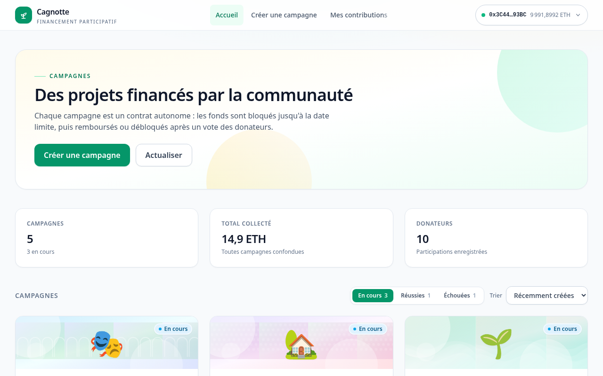

*Figure 1 — Accueil : statistiques globales, filtres par état et campagnes en cours.*

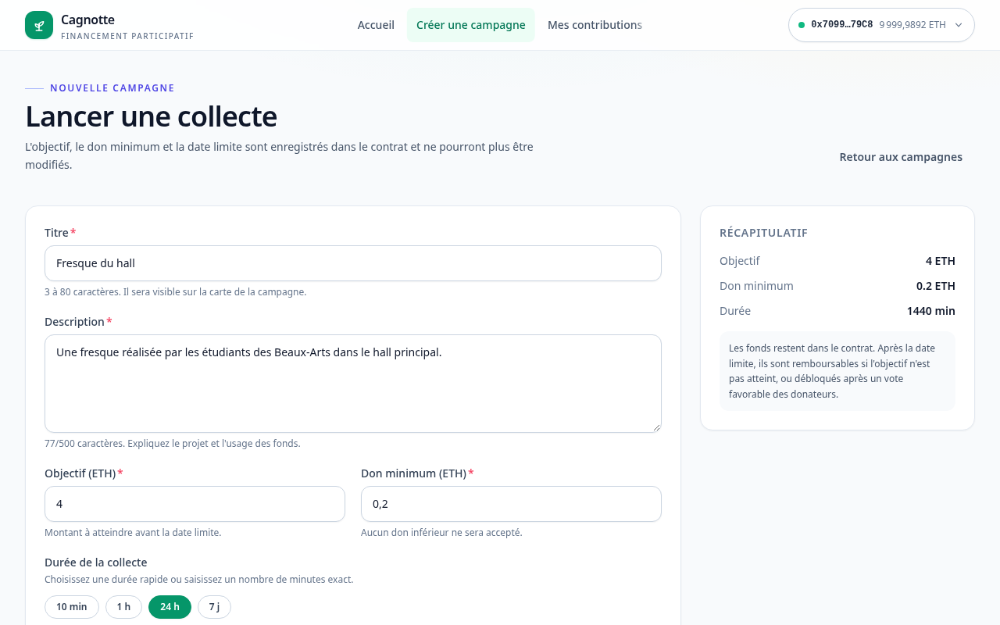

*Figure 2 — Création d'une campagne : formulaire, durées rapides et récapitulatif.*

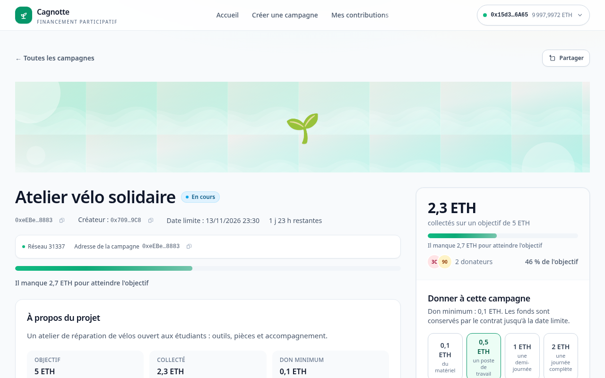

*Figure 3 — Campagne en cours : progression, compte à rebours et formulaire de don avec montants proposés.*

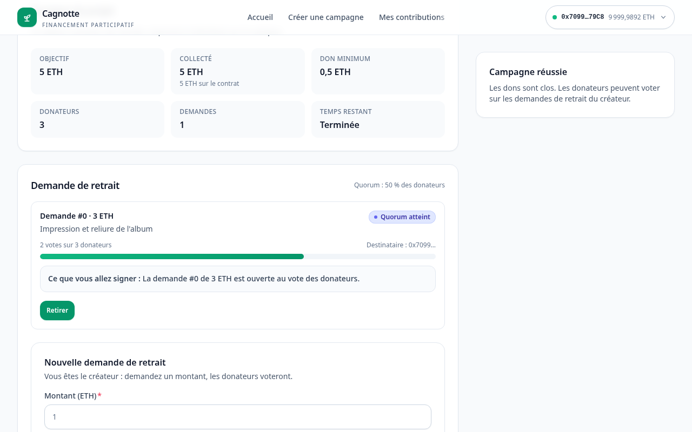

*Figure 4 — Campagne réussie, vue du créateur : demande de retrait approuvée par 2 donateurs sur 3 (quorum atteint) et bouton « Retirer ».*

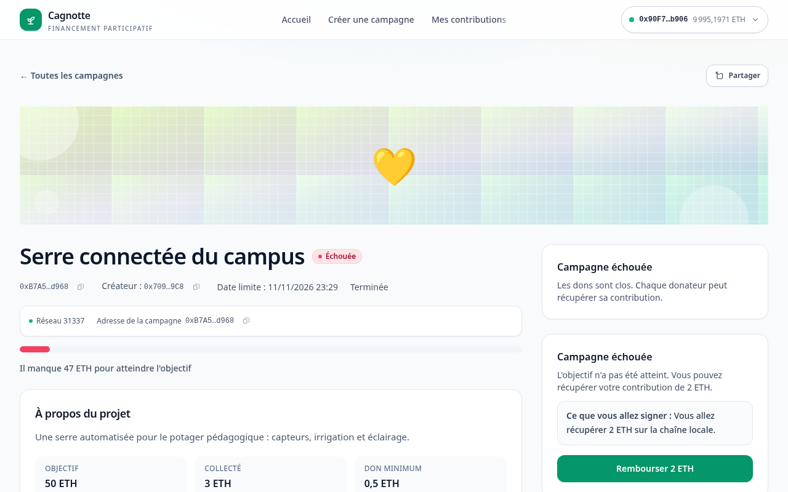

*Figure 5 — Campagne échouée, vue d'un donateur : remboursement de sa contribution de 2 ETH.*

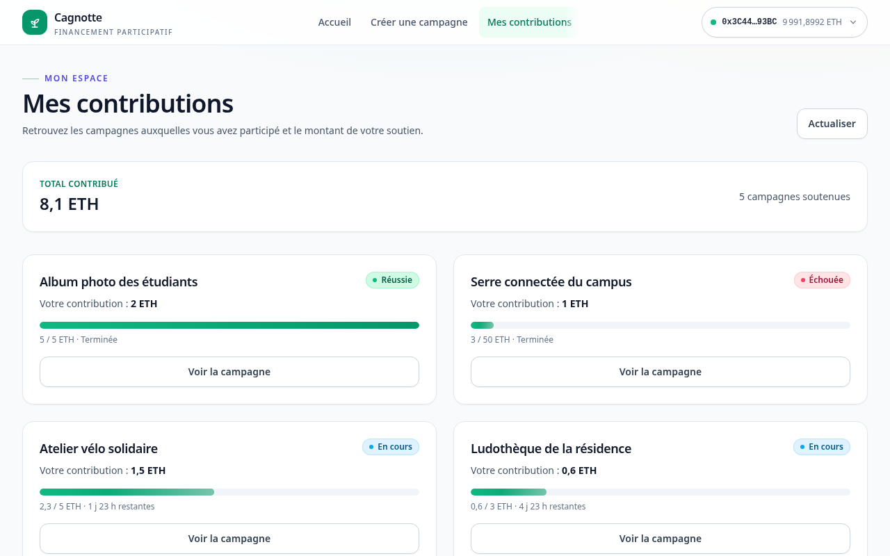

*Figure 6 — Mes contributions : total donné par le compte connecté et état de chaque campagne soutenue.*

<p align="center">
  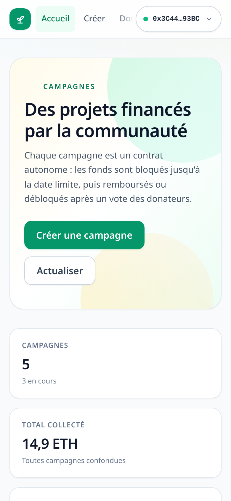
  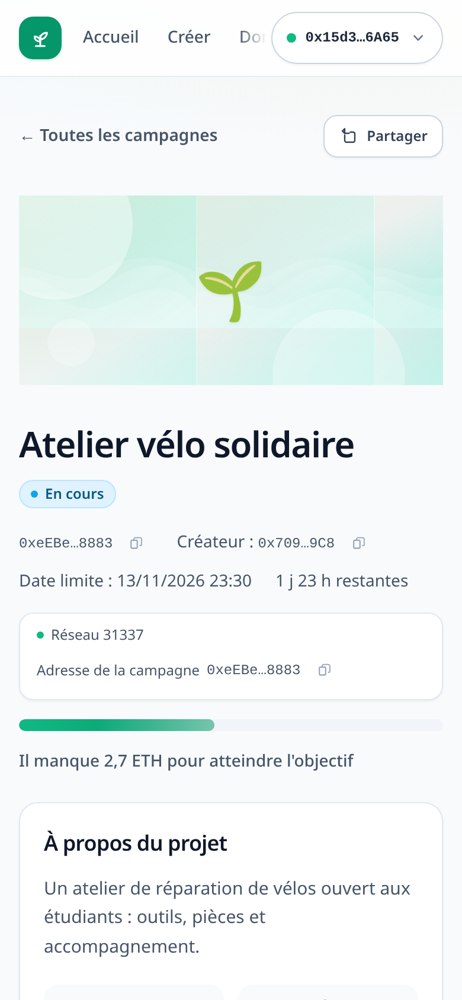
  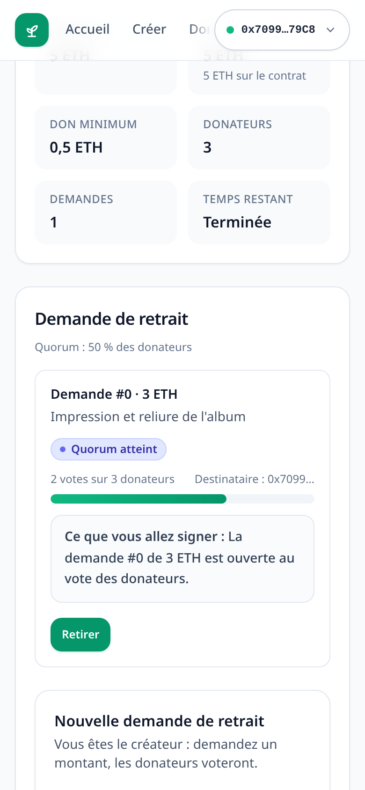
  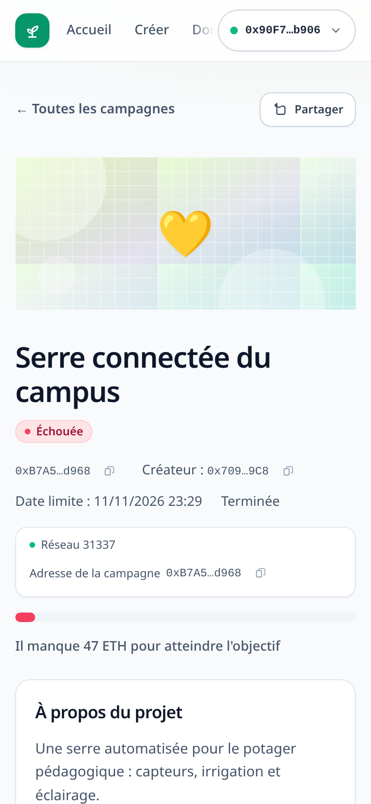
</p>

*Figure 7 — Les mêmes pages sur téléphone (390 px de large) : accueil, campagne en cours, vote et retrait, remboursement.*

### 6.5 Gestion des erreurs et accessibilité

Les 20 messages `require` du contrat sont traduits en français dans `web3/errors.js`, ainsi que le refus MetaMask (code 4001), les fonds insuffisants et l'absence de RPC. Les transactions affichent un état `pending`, désactivent le bouton et rafraîchissent les données après confirmation. Les toasts sont accessibles (`aria-live`, fermeture au clavier), les formulaires associent label, hint et erreur (`aria-invalid`, `aria-describedby`), les barres de progression exposent `role="progressbar"` et les pages restent utilisables à 360 px.

### 6.6 Tests

Le frontend utilise **Vitest**, **Testing Library** et **jsdom** :

```text
16 fichiers, 198 tests
format 60 · errors 41 · walletSlice 23 · projects 13 · campaignTheme 9 · ProjectPage 8
useAsyncData 7 · ProgressBar 6 · CopyAddress 5 · Countdown 5 · useTransaction 5
DonationPresets 4 · ErrorBoundary 3 · HomePage 3 · ProjectCard 3 · provider 3
```

Les tests couvrent le formatage, le mapping d'erreurs, la couche de données (avec contrats mockés), le store du portefeuille, les hooks, les composants et la visibilité des actions selon le statut, le rôle et la contribution. Ils vérifient aussi les trois corrections décrites au chapitre 7 : refus de signer sur un mauvais réseau, formulaire réaffiché après un changement de compte, compte à rebours calé sur l'horloge de la chaîne. Le build de production passe (238 modules) et la CI exécute `npm test` puis `npm run build`.

---

## 7. Recette et validation

La fiche détaillée est dans `docs/commun/RECETTE.md`. Les scénarios A à F sont validés à trois niveaux : les tests des contrats (les règles), les tests du frontend (l'affichage, avec des contrats simulés) et des tests de bout en bout qui rejouent chaque scénario dans un vrai navigateur.

### 7.1 Tests de bout en bout (Playwright)

`npm run e2e` lance une blockchain Hardhat neuve, déploie la fabrique, compile l'application pour la production et pilote Chromium avec **Playwright**. Un portefeuille de test, injecté à la place de MetaMask (interface EIP-1193), répond aux demandes de compte et de réseau et fait signer les transactions par le nœud Hardhat, sans clé privée dans le code. Le scénario A se joue comme en démo : un seul navigateur, avec un changement de compte entre chaque étape.

| Scénario | Vérification automatique | Résultat |
| --- | --- | --- |
| A — succès, vote, retrait | 3 dons de 2 ETH depuis trois comptes, demande de 4 ETH, 2 votes sur 3, retrait | ✅ le destinataire reçoit exactement 4 ETH |
| B — échec, remboursement | objectif 50 ETH, dons de 1 et 2 ETH, deux remboursements | ✅ chaque donateur récupère sa mise (moins le gaz), contrat à 0 ETH |
| C — don invalide | don sous le minimum ; don après la date limite | ✅ refus avant l'envoi ; refus du contrat affiché en français ; formulaire masqué une fois la campagne finie |
| D — quorum insuffisant | 1 vote sur 3 | ✅ pas de bouton « Retirer », appel direct refusé par le contrat |
| E — doubles actions | double vote, retrait par un non-créateur, double remboursement | ✅ actions absentes de l'interface et refusées par le contrat |
| F — sans MetaMask | lecture des campagnes | ✅ lecture complète, aucune action d'écriture |
| Réseau | portefeuille resté sur une autre chaîne | ✅ aucune transaction envoyée, message clair |

Résultat au 2026-11-11 : **12 tests sur 12 réussis**, en local (environ 30 s) et dans la CI GitHub Actions (job `e2e`, relancé à chaque push).

### 7.2 Défauts corrigés

Une relecture de l'interface a relevé trois défauts, que les tests de bout en bout reproduisent. Les tests unitaires d'origine ne pouvaient pas les voir : ils simulent les contrats et ne changent ni de compte, ni de réseau, ni d'horloge.

1. **Changement de compte** : après une action réussie, l'écran « Merci ! » restait affiché pour le compte suivant et cachait Donner, Voter, Retirer et Rembourser jusqu'au rechargement de la page. Le scénario A était bloqué en démo. Correction : les cartes d'action sont recréées à chaque changement de compte (clé React liée au compte).
2. **Mauvais réseau** : avec MetaMask resté sur une autre chaîne, Voter, Retirer, Rembourser et Créer la demande envoyaient quand même la transaction vers ce réseau. Correction : `getSigner()` vérifie la chaîne avant toute signature, et l'interface affiche « Mauvais réseau : passez sur Hardhat Local (31337) ».
3. **Horloge** : après `npm run ff`, le compte à rebours suivait l'horloge du navigateur et affichait encore des minutes restantes à côté du badge « Réussie ». Correction : le compte à rebours se cale sur l'heure vue par le contrat (`deadline - timeLeft`).

Chaque correction est couverte par des tests unitaires, qui échouent tous sur le code d'origine, et par les tests de bout en bout des scénarios A et B et du réseau.

### 7.3 Bilan des tests

| Niveau | Outil | Tests |
| --- | --- | --- |
| Contrats | Mocha + Chai (Hardhat) | 82, couverture 100 % |
| Frontend | Vitest + Testing Library | 198 |
| Bout en bout | Playwright + Chromium | 12 |

### 7.4 Limites de la validation

- Le portefeuille de test remplace l'extension : les fenêtres de confirmation de la vraie extension MetaMask restent à vérifier à la main, avec la fiche `RECETTE.md`.
- Le multi-PC (`--hostname 0.0.0.0` + `--host`) est documenté mais n'a pas été mesuré dans cet environnement.
- La vidéo de secours reste à produire par l'équipe. Les captures d'écran sont faites (section 6.4) et se régénèrent avec `npm run e2e:captures`.

---

## 8. Conclusion

Le projet montre qu'un smart contract peut remplacer un intermédiaire de confiance pour une collecte conditionnelle : les règles sont vérifiables, les fonds sont isolés et les remboursements sont automatiques. La principale difficulté n'est pas le code, mais la conception des incitations et des cas limites : quorum, abstention, fonds bloqués, cumul des demandes.

Perspectives : déploiement sur Sepolia, vote pondéré par le montant, stockage des descriptions sur IPFS, annulation des demandes, plafond du nombre de donateurs, audit externe.
