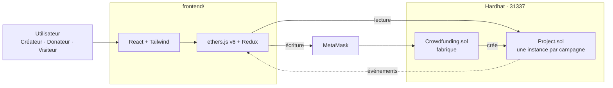
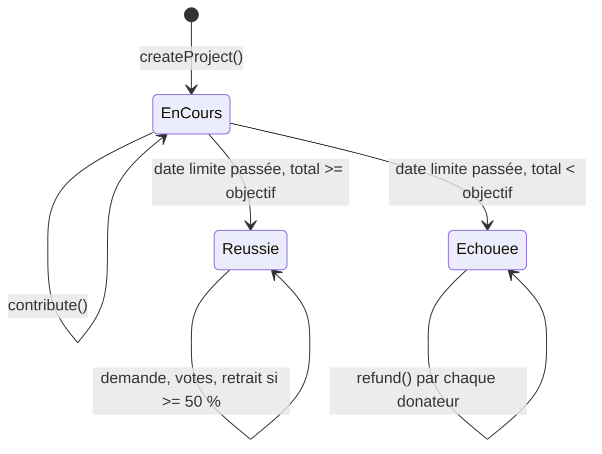

# Rapport de projet — Plateforme de financement participatif sur blockchain

**Équipe :** 4 étudiants
**Stack :** Solidity 0.8.24 · Hardhat · Hardhat Ignition · ethers.js v6 · React · Redux Toolkit · Tailwind CSS · MetaMask
**Réseau de démonstration :** Hardhat local, chainId `31337`

---

## 1. Introduction et contexte

Le financement participatif classique repose sur un intermédiaire : une plateforme collecte les fonds, prélève une commission et décide des conditions de déblocage. Les contributeurs doivent lui faire confiance pour conserver les fonds, vérifier l'usage promis et rembourser en cas d'échec.

Ce projet remplace cet intermédiaire par un **smart contract** déployé sur Ethereum. Une campagne est un contrat autonome qui :

- conserve les fonds des donateurs ;
- applique des règles fixées à la création (objectif, don minimum, date limite) ;
- n'autorise le créateur à retirer les fonds qu'après un vote favorable des donateurs ;
- rembourse automatiquement chaque donateur si l'objectif n'est pas atteint.

L'objectif pédagogique est double : concevoir un contrat correct et sûr, puis construire une interface web complète qui rend le cycle de vie d'une campagne visible et manipulable avec MetaMask.

Le projet suit trois phases : contrats et sécurité (phase 1), interface web et données de démo (phase 2), recette, rapport et démonstration (phase 3).

---

## 2. Spécifications

### 2.1 Acteurs

| Acteur | Rôle |
| --- | --- |
| Visiteur | consulte les campagnes sans portefeuille |
| Donateur | connecte MetaMask, donne, vote, retire son remboursement |
| Créateur | lance une campagne, demande un retrait, exécute le retrait approuvé |

Un même compte peut être créateur d'une campagne et donateur d'une autre. Le créateur peut aussi donner à sa propre campagne.

### 2.2 Fonctionnalités

| Réf. | Fonctionnalité | Fonction |
| --- | --- | --- |
| F1 | Créer une campagne (titre, description, objectif, don minimum, durée) | `Crowdfunding.createProject()` |
| F2 | Donner avant la date limite, montant ≥ minimum | `Project.contribute()` |
| F3 | Consulter objectif, date limite, total, donateurs, temps restant, état | `getStatus()`, `timeLeft()`, `getDonors()` |
| F4 | Demander un retrait (montant, motif, destinataire) si la campagne réussit | `createWithdrawRequest()` |
| F5 | Voter, puis retirer si au moins 50 % des donateurs approuvent | `voteWithdrawRequest()`, `withdrawRequestedAmount()` |
| F6 | Se faire rembourser si le total est inférieur à l'objectif après la date limite | `refund()` |
| F7 | Interface web avec MetaMask | `frontend/` |

### 2.3 Règles de gestion

| Réf. | Règle | Mise en œuvre |
| --- | --- | --- |
| RG1 | Paramètres positifs, date limite dans le futur | `require` du constructeur et durée > 0 |
| RG2 | Pas de don après la date limite ni sous le minimum | `require` de `contribute()` |
| RG3 | Fonds bloqués jusqu'à la date limite | aucune sortie possible pendant l'état « En cours » |
| RG4 | Retrait si au moins 50 % des donateurs approuvent | `approvals * 2 >= donors.length` |
| RG5 | Chaque donateur récupère sa contribution, une seule fois | contribution remise à 0 avant l'envoi |

### 2.4 Écarts assumés par rapport au cahier des charges

Trois choix ont été faits pour simplifier le contrat sans réduire les garanties :

1. **État calculé, non stocké.** `getStatus()` compare l'horloge et le total collecté. Aucune transaction n'est nécessaire pour clôturer une campagne, et l'état ne peut pas être incohérent.
2. **Durée au lieu d'une date.** L'interface saisit des minutes ; le contrat calcule `deadline = block.timestamp + duration`. Cela supprime les problèmes de fuseau horaire et de date passée.
3. **Fabrique de campagnes.** Un contrat `Crowdfunding` déploie un contrat `Project` par campagne. Chaque campagne isole ses fonds et ses donateurs, et la liste globale reste simple à parcourir.

---

## 3. Architecture



- **Crowdfunding** est déployé une fois. Il crée les campagnes et expose la liste des adresses.
- **Project** est déployé par la fabrique. Il contient les fonds, les contributions et les demandes de retrait d'une seule campagne.
- Le frontend utilise deux fournisseurs : `BrowserProvider` pour signer avec MetaMask, `JsonRpcProvider` pour lire sans portefeuille.
- Les événements (`DonationReceived`, `WithdrawVote`, `FundsWithdrawn`, `Refunded`) permettent de rafraîchir l'interface sans interrogation constante.

Cette séparation evite un contrat monolithique : une campagne ne peut pas modifier les fonds d'une autre, et la fabrique n'a aucun droit sur les fonds.

---

## 4. Smart contracts et sécurité

### 4.1 `Crowdfunding.sol`

| Élément | Rôle |
| --- | --- |
| `createProject(title, description, goal, minContribution, duration)` | déploie un `Project`, l'ajoute à la liste, émet `ProjectCreated` |
| `getProjects()` / `getProjectsCount()` | lecture de la liste |
| `projects(uint256)` | lecture d'une adresse par index |

Le créateur enregistré est `msg.sender`. La fabrique ne conserve aucun ETH et n'a pas de fonction de retrait : elle ne peut pas toucher aux fonds des campagnes.

### 4.2 `Project.sol`

**Données immuables :** créateur, objectif, don minimum, date limite. Le titre et la description sont en lecture seule après création.

**Données mutables :** total collecté, contributions par adresse, liste des donateurs, demandes de retrait, votes.

**Cycle de vie :**



L'état est calculé :

```solidity
if (block.timestamp < deadline) return State.Ongoing;
return totalRaised >= goal ? State.Successful : State.Failed;
```

**Vote et retrait.** Une voix par donateur, quel que soit le montant. Le quorum porte sur le nombre de donateurs, pas sur les montants : une abstention ne réduit donc pas le seuil. Une demande est exécutable si `approvals * 2 >= donors.length`. Le créateur peut cumuler plusieurs demandes, mais chaque exécution vérifie le solde réel.

### 4.3 Sécurité

| Risque | Protection |
| --- | --- |
| Réentrance sur `refund()` | contribution remise à 0 **avant** l'appel externe |
| Réentrance sur le retrait | `executed = true` **avant** l'appel externe |
| Double vote | mapping `hasVoted[id][adresse]` |
| Double remboursement | contribution remise à 0 |
| Retrait par un non-créateur | modificateur `onlyCreator` |
| Demande sur une campagne non réussie | `require(getStatus() == Successful)` |
| Destinataire nul | `require(recipient != address(0))` |
| Virement refusé | `require(ok)` : la transaction entière est annulée |
| Envoi direct d'ETH | pas de `receive()` ni de `fallback()` |

Le contrat n'utilise pas `nonReentrant` : l'ordre des opérations (checks-effects-interactions) suffit, et les tests d'attaque le vérifient. L'atomicité d'Ethereum garantit qu'un `revert` annule aussi la mise à jour d'état.

### 4.4 Limites connues

- Le quorum porte sur le nombre de donateurs : un créateur qui est seul donateur peut approuver sa propre demande à 100 %.
- Les demandes de retrait ne peuvent pas être annulées.
- Les tableaux de donateurs et de demandes ne sont pas bornés : un nombre très élevé de donateurs augmenterait le coût du vote et du retrait.
- Une campagne réussie dont le créateur ne fait jamais de demande laisse les fonds bloqués dans le contrat.
- Les attaques Sybil (plusieurs comptes pour un même utilisateur) ne sont pas empêchées.
- Le contrat n'est pas audité et n'a pas de mécanisme de mise à jour.

---

## 5. Tests et déploiement

### 5.1 Tests

La suite utilise Mocha, Chai et Hardhat. Les tests sont isolés par `loadFixture`, ce qui redéploie un état propre pour chaque scénario.

| Groupe | Nombre | Exemples |
| --- | --- | --- |
| Déploiement | 5 | paramètres enregistrés, refus d'un créateur/objectif/minimum/durée invalide |
| Dons | 5 | don accepté, pas de doublon, refus sous le minimum, refus après la date, refus d'un envoi direct |
| États et temps | 4 | réussie, échouée, reste en cours si l'objectif est atteint avant la fin, `timeLeft` |
| Demande de retrait | 6 | accès créateur, campagne réussie, montant, destinataire, événement |
| Vote et retrait | 12 | non-donateur, double vote, quorum 1/3 et 2/3, second retrait, cumul |
| Remboursement | 7 | montant exact, événement, double remboursement, non-donateur, campagne réussie |
| Sécurité | 3 | réentrance sur `refund`, virement refusé, retrait annulé |
| **Total** | **47** | **42 `Project` + 5 `Crowdfunding`** |

Résultat mesuré le 2026-11-10 :

```text
47 passing (869ms)
```

### 5.2 Couverture

```text
contracts/Crowdfunding.sol   100 % statements · 100 % branches · 100 % functions · 100 % lines
contracts/Project.sol        100 % statements · 100 % branches · 100 % functions · 100 % lines
```

Les contrats d'attaque (`contracts/test/`) sont exclus de la mesure par `.solcover.js`. La couverture ne prouve pas l'absence de bugs, mais elle indique que chaque branche du code est exercée au moins une fois.

### 5.3 Déploiement

Hardhat Ignition déploie la fabrique de façon déterministe :

```bash
npm run deploy
# CrowdfundingModule#Crowdfunding - 0x5FbDB2315678afecb367f032d93F642f64180aa3
```

Scripts associés :

| Commande | Rôle |
| --- | --- |
| `npm run node` | lance la blockchain locale |
| `npm run deploy` | déploie la fabrique |
| `npm run deploy:reset` | redéploie après un redémarrage du nœud |
| `npm run sync` | copie les ABI et l'adresse vers `frontend/src/` |
| `npm run simulate` | rejoue les scénarios A et B sans interface |
| `npm run seed` | crée trois campagnes de démonstration |
| `SECONDS=120 npm run ff` | avance l'horloge locale |

La CI GitHub Actions exécute l'installation, la compilation, les 47 tests, la couverture, un déploiement Ignition à blanc et le build du frontend. Le hook `pre-commit` exécute les mêmes vérifications avant chaque commit.

### 5.4 Données de démonstration

`npm run seed` crée trois campagnes :

| Campagne | Objectif | Dons | État final |
| --- | --- | --- | --- |
| Atelier vélo solidaire | 5 ETH | 0,5 ETH | En cours |
| Album photo des étudiants | 5 ETH | 2 + 2 + 1 ETH | Réussie |
| Serre connectée du campus | 50 ETH | 1 + 2 ETH | Échouée |

Le script avance l'horloge de 700 secondes pour clôturer les deux campagnes courtes, puis vérifie les états `0`, `2` et `1` avant d'afficher un tableau récapitulatif.

---

## 6. Interface web

> Cette section est complétée après l'implémentation du frontend (phase 2).

---

## 7. Recette et validation

> Cette section est complétée après la recette des scénarios A à F. Voir `docs/commun/RECETTE.md`.

---

## 8. Conclusion

Le projet montre qu'un smart contract peut remplacer un intermédiaire de confiance pour une collecte conditionnelle : les règles sont vérifiables, les fonds sont isolés et les remboursements sont automatiques. La principale difficulté n'est pas le code, mais la conception des incitations et des cas limites : quorum, abstention, fonds bloqués, cumul des demandes.

Perspectives : déploiement sur Sepolia, vote pondéré par le montant, stockage des descriptions sur IPFS, annulation des demandes, plafond du nombre de donateurs, audit externe.
